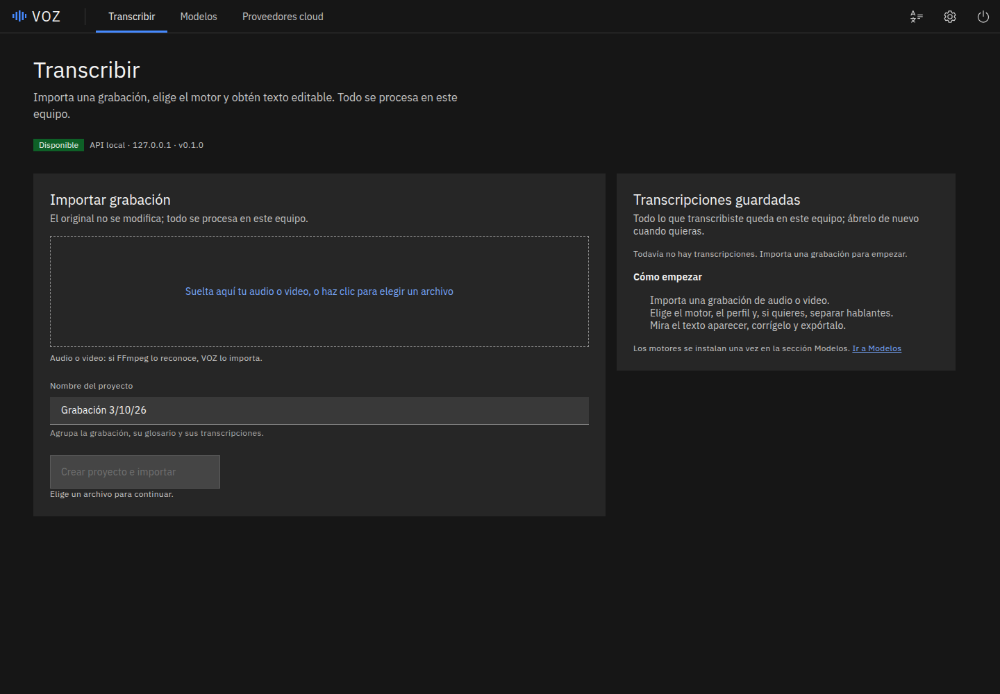
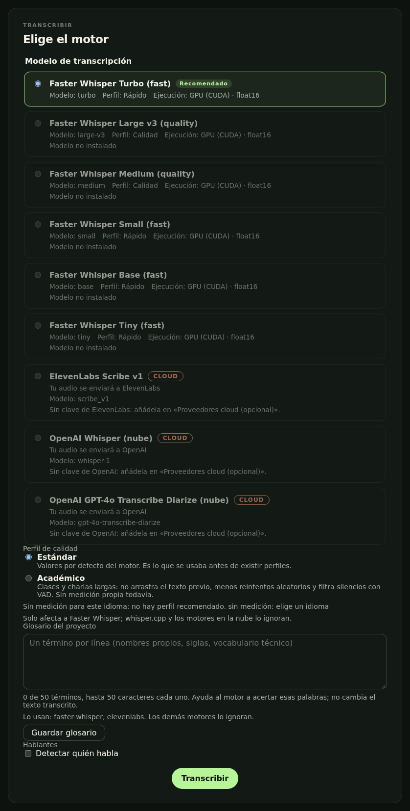
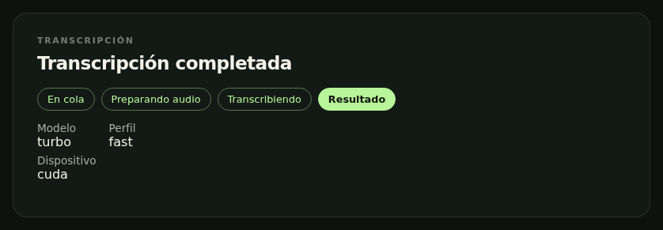
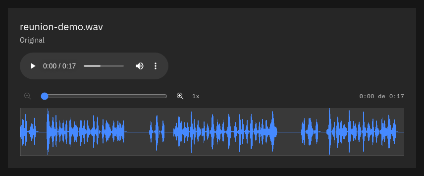
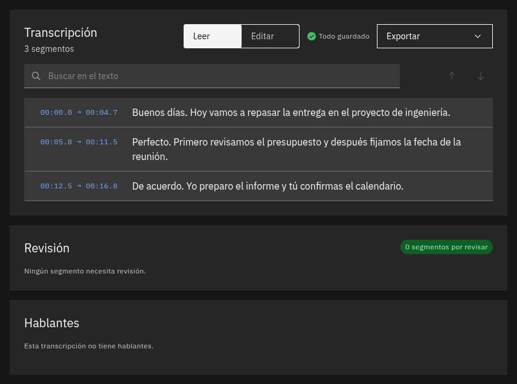
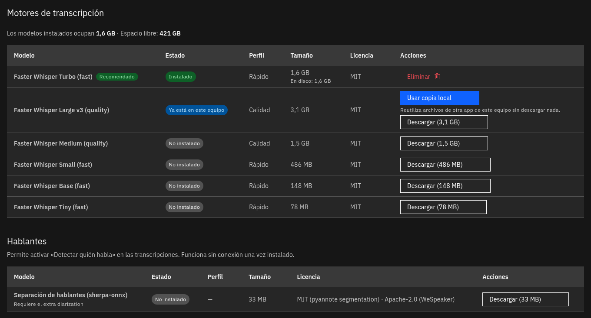

# VOZ

VOZ es un proyecto local-first para transcribir, revisar y exportar grabaciones
largas de clases, entrevistas y reuniones. La meta es ofrecer un workspace web
local con waveform, timeline, segmentos editables y hablantes, sin convertir un
proveedor cloud en requisito.

## Cómo abrirlo (sin saber programar)

No necesitas instalar Python, ni Node, ni FFmpeg.

1. **Descarga el proyecto.** En [GitHub Desktop](https://desktop.github.com):
   *File → Clone repository → URL* y pega
   `https://github.com/MarshallGomez1103/voz`. O descarga el ZIP desde GitHub
   (*Code → Download ZIP*) y descomprímelo.
2. **Abre la carpeta y haz doble clic en el archivo de tu equipo:**

   | Equipo | Archivo |
   |---|---|
   | Windows | `Iniciar-Windows.bat` |
   | Mac | `Iniciar-Mac.command` |
   | Linux | `Iniciar-Linux.sh` (o `./Iniciar-Linux.sh` en la terminal) |

3. **Espera.** La primera vez descarga lo necesario y tarda unos minutos; luego
   se abre el navegador solo. Las siguientes veces tarda segundos.
4. **En la página, descarga un modelo** (sección *Modelos*; `turbo` es el
   recomendado), arrastra tu grabación y pulsa *Transcribir*.

Para cerrar VOZ, usa el botón de apagado arriba a la derecha (o cierra la
ventana negra que se abrió con él). Si lo abres dos veces, solo se abre otra
pestaña. Tus grabaciones, modelos y transcripciones se quedan en tu equipo.

**Como una aplicación:** en *Ajustes* (el engranaje) puedes crear un icono en el
escritorio que abre VOZ con doble clic. Y en Chrome o Edge, el botón *Instalar*
de la barra de direcciones le da a VOZ su propia ventana e icono, sin barra del
navegador (el servidor tiene que estar abierto). Fuera de la carpeta solo se
instalan uv y su propio Python, sin tocar otros programas.

**Si algo no va:**

- **Windows dice "Windows protegió su PC":** *Más información → Ejecutar de
  todas formas*.
- **Mac dice que no puede abrirlo:** clic derecho sobre el archivo → *Abrir*. Si
  no aparece la opción: *Ajustes del Sistema → Privacidad y seguridad → Abrir
  igualmente*.
- **Windows dice "ruta demasiado larga" (path too long):** mueve la carpeta a
  un sitio corto, por ejemplo `C:\Voz`, y vuelve a abrir el archivo.
- **Va lento:** sin tarjeta NVIDIA, VOZ transcribe con el procesador. Funciona,
  pero una hora de audio puede tardar bastante; el modelo `turbo` es el más
  rápido con buena calidad.

## Qué hace

- **Faster Whisper** (`turbo` y `large-v3`) en tu equipo: con GPU NVIDIA si la
  tienes, si no con el procesador. El gestor de modelos los descarga y borra.
- **Hablantes** separados en local con sherpa-onnx (sin cuentas ni tokens),
  editables y fusionables.
- **Palabras con tiempos**, forma de onda con zoom, reproductor sincronizado,
  búsqueda, edición con autoguardado y exportación TXT, Markdown, SRT, VTT y
  JSON.
- **Calidad**: perfiles reproducibles (`default`, `academic` con filtro de
  silencios), glosario por proyecto, avisos de posibles alucinaciones y cola de
  revisión; `voz bench` mide velocidad y tasa de error.
- **Opcionales**: whisper.cpp (si existe `whisper-cli`) y proveedores cloud con
  tu propia clave, consentimiento explícito y estimación de coste
  (experimentales).

Verificado a fondo en Linux con una RTX 4060. Windows y macOS corren las pruebas
automáticas en CI, pero aún no se han usado a mano. No hay release publicada.
Qué está verificado y cómo: [ROADMAP.md](ROADMAP.md),
[docs/benchmarks.md](docs/benchmarks.md).

## Capturas

Capturas reales de VOZ en local con Faster Whisper `turbo` en GPU
([docs/demo.md](docs/demo.md) explica cómo regenerarlas con
`scripts/capture-screenshots.sh`).

| Inicio | Elegir motor |
| --- | --- |
|  |  |

| Job terminado | Forma de onda del original |
| --- | --- |
|  |  |

| Transcripción | Gestor de modelos |
| --- | --- |
|  |  |

## Visión

La experiencia objetivo es:

```text
$ voz

VOZ 0.x
Servidor: http://127.0.0.1:8765
Abriendo navegador...
```

Desde la interfaz, el usuario podrá importar un archivo que FFmpeg pueda
decodificar, elegir un perfil de procesamiento, seguir el progreso, corregir el
transcript y exportarlo. Los originales serán inmutables y los resultados de
trabajos largos se guardarán incrementalmente.

## Principios

- local y privado por defecto;
- funcionamiento offline con modelos ya descargados;
- motores intercambiables detrás de contratos comunes;
- UI siempre responsiva mediante jobs asíncronos;
- originales inmutables y procesamiento reproducible;
- recuperación mediante checkpoints para grabaciones largas;
- arquitectura extensible sin microservicios prematuros.

## Alcance planificado

El MVP comprende:

- CLI `voz` y servidor web local;
- importación y normalización con FFmpeg;
- transcripción local con Faster Whisper;
- progreso y reanudación de trabajos largos;
- edición sincronizada con waveform;
- diarización editable de hablantes;
- exportación TXT, Markdown, SRT, VTT y JSON.

Más allá del MVP ya existen palabras con timestamps, whisper.cpp, Model Manager,
perfiles de calidad, benchmark y proveedores cloud opcionales. La lista
autoritativa, con IDs estables y estado verificable, está en
[ROADMAP.md](ROADMAP.md).

## Privacidad

VOZ está diseñado para enlazarse únicamente a `127.0.0.1` por defecto. Un
proveedor cloud nunca debe activarse implícitamente: el usuario tendrá que
configurarlo y seleccionarlo de forma explícita.

No deben entrar en Git:

- grabaciones o transcripts privados;
- modelos y archivos multimedia generados;
- bases de datos, caches o datos XDG de ejecución;
- claves API, `.env` o secretos;
- contexto local de agentes en `.ai/`.

No uses grabaciones privadas como fixtures de pruebas.

## Arquitectura

VOZ adopta un monolito modular local con límites Clean/Hexagonal:

```text
React UI
   |
FastAPI / Typer interfaces
   |
Application use cases and ports
   |
Domain
   ^
Infrastructure adapters: SQLite, FFmpeg, ASR, diarization, cloud
```

El dominio no depende de FastAPI, SQLAlchemy, FFmpeg, torch ni SDKs externos.
Los detalles y consecuencias están documentados en
[ADR-0001](docs/adr/0001-modular-monolith.md). La frontera multimedia y sus
garantías de integridad están en
[ADR-0003](docs/adr/0003-ffmpeg-ingestion.md). La instalación local explícita,
selección de hardware y recuperación ASR están en
[ADR-0004](docs/adr/0004-local-asr-and-recoverable-chunks.md).

## Desarrollo local

La consulta `GET /api/transcription-options` expone opciones conocidas,
registro local, disponibilidad del runtime, ejecución y bloqueos sin cargar
modelos. Su [contrato y límites](docs/api/transcription-options.md) distinguen
registro de integridad y recomendación de benchmark. Los endpoints de
proyectos, subida, jobs y eventos SSE están descritos en
[docs/api/jobs.md](docs/api/jobs.md). Los datos viven bajo XDG
(`$XDG_DATA_HOME/voz/voz.sqlite3`, originales y derivados por proyecto) y el
esquema se migra automáticamente al arrancar.

Para retomar el desarrollo en otra sesión, lee `AGENTS.md`, el apartado
“Retomar en una sesión nueva” de [ROADMAP.md](ROADMAP.md) y `.ai/HANDOFF.md`
cuando exista. Los próximos cortes propuestos están al final del tablero de
Sección 5 en el roadmap.

No hay release pública todavía. Instalación en Linux desde un wheel (`uv tool
install`), extra `asr-local` (Faster Whisper con GPU NVIDIA) y rutas XDG:
[docs/install/linux.md](docs/install/linux.md). Historial en
[CHANGELOG.md](CHANGELOG.md), versionado y API pública en
[docs/release.md](docs/release.md). Modelos y reutilización del cache de Buzz:
[docs/models.md](docs/models.md), [docs/buzz.md](docs/buzz.md). Para instalar
el checkout y ejecutar la Home local integrada:

```bash
uv sync --all-groups
uv run voz --no-browser
```

El runtime Faster Whisper es opcional y no altera el bootstrap ordinario:

```bash
uv sync --all-groups --extra asr-local
```

Ese comando instala la dependencia, no los pesos. La instalación de un modelo
requiere un descriptor con repositorio y SHA de commit de 40 caracteres, además
de confirmación explícita. Para probar un directorio de modelo ya instalado sin
red, se ofrece un smoke CPU opt-in:

```bash
VOZ_FASTER_WHISPER_MODEL_DIR=/ruta/al/model \
VOZ_FASTER_WHISPER_MODEL_SOURCE=organizacion/repositorio \
VOZ_FASTER_WHISPER_MODEL_REVISION=sha_git_de_40_caracteres \
  uv run pytest tests/integration/application/test_faster_whisper_real_opt_in.py
```

CUDA continúa rotulado como experimental hasta ejercitarlo en hardware real.

La aplicación queda disponible en `http://127.0.0.1:8765` y expone
`GET /api/health`. Para revisar prerrequisitos sin arrancar el servidor:

```bash
uv run voz doctor          # añade --json o --redact si lo necesitas
```

Para modificar y reconstruir el frontend:

```bash
cd apps/web
npm ci
npm run build
```

Para Bazzite/Fedora Atomic consulta la
[guía de setup](docs/development/setup-bazzite.md). No se recomienda modificar la
imagen base con `rpm-ostree` para el bootstrap ordinario.

## Comprobaciones previstas

Backend:

```bash
uv run ruff check .
uv run ruff format --check .
uv run pyright
uv run pytest
```

Frontend:

```bash
cd apps/web
npm run lint
npm run typecheck
npm run test
npm run build
```

Un item del roadmap solo se marca como terminado después de ejecutar y registrar
las comprobaciones aplicables.

## Colaboración

Antes de trabajar lee [AGENTS.md](AGENTS.md), selecciona entre uno y tres items
estrechamente relacionados del roadmap y registra la asignación. Las decisiones
arquitectónicas durables se documentan como ADR; las notas privadas y transitorias
de sesión permanecen en `.ai/` y no se versionan.

La contribución externa todavía no está abierta formalmente: faltan la guía de
contribución, políticas comunitarias, plantillas y una versión publicable. Esos
trabajos están registrados en la Sección 16.

## Licencia

VOZ se distribuye bajo la [licencia MIT](LICENSE). Cualquier código de terceros
incorporado deberá conservar sus avisos y quedar registrado en `NOTICE` cuando
corresponda.

## Documentación de planificación

- [Plan maestro](VOZ_PLAN_MAESTRO.md)
- [Roadmap ejecutable](ROADMAP.md)
- [Reglas de ingeniería](AGENTS.md)
- [ADR-0001: monolito modular](docs/adr/0001-modular-monolith.md)
- [ADR-0002: persistencia SQLite](docs/adr/0002-sqlite-persistence.md)
- [ADR-0003: ingestión FFmpeg](docs/adr/0003-ffmpeg-ingestion.md)
- [ADR-0004: ASR local recuperable](docs/adr/0004-local-asr-and-recoverable-chunks.md)
- [ADR-0005: providers de transcripción](docs/adr/0005-transcription-providers.md)
- [ADR-0006: local-first y privacidad](docs/adr/0006-local-first-privacy.md)
- [Arquitectura C4: contexto, contenedores y componentes](docs/architecture/README.md)
- [Setup de desarrollo en Bazzite](docs/development/setup-bazzite.md)
