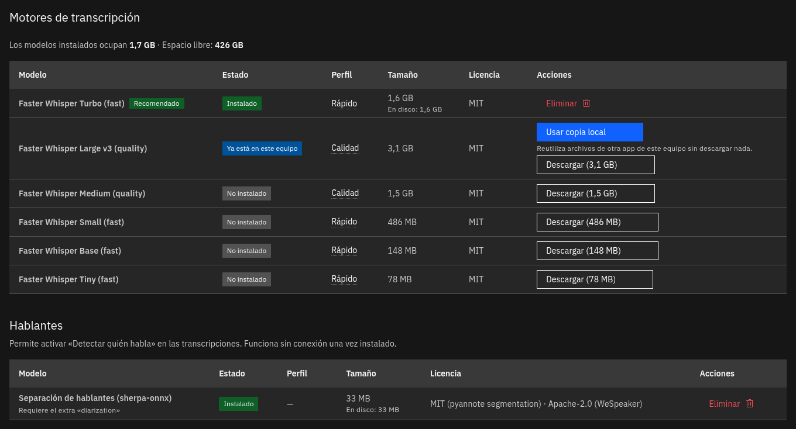
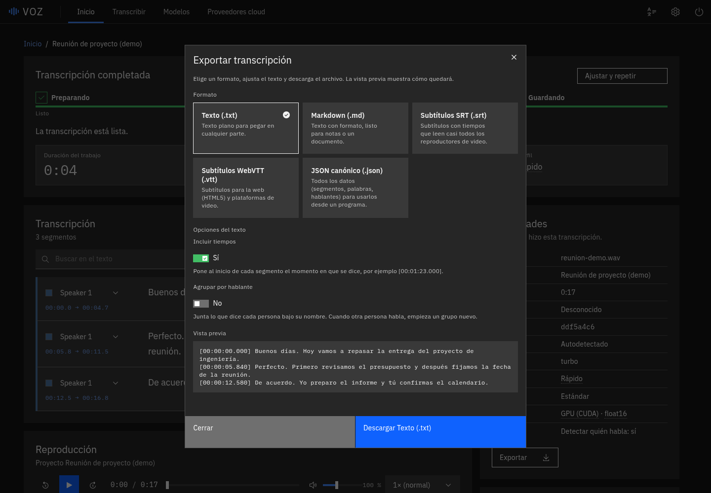

# V

**Local Voice AI** (formerly VOZ)

V is a local-first application that runs speech models on your own computer.
Today it transcribes long recordings (classes, interviews, meetings) into
editable, speaker-labelled transcripts, without sending your audio anywhere.
It is a local web app: you start a server on your machine and use it from your
browser.

> **Status:** pre-release. No version has been published or tagged; the tree
> version is `0.1.0`. Expect rough edges, and see
> [Supported platforms](#supported-platforms) for what has actually been tested.

## Contents

- [What V does today](#what-v-does-today)
- [Screenshots](#screenshots)
- [Supported platforms](#supported-platforms)
- [Installation](#installation)
- [Running V](#running-v)
- [Hardware requirements](#hardware-requirements)
- [Engines and models](#engines-and-models)
- [Privacy and offline use](#privacy-and-offline-use)
- [Architecture](#architecture)
- [Development](#development)
- [Testing](#testing)
- [Contributing](#contributing)
- [Security](#security)
- [Licensing](#licensing)
- [Roadmap](#roadmap)
- [Documentation index](#documentation-index)

## What V does today

Everything in this list exists in the repository and is covered by the project's
tests (see [CHANGELOG.md](CHANGELOG.md) and [ROADMAP.md](ROADMAP.md) for the
verified detail).

- **Local transcription** with [faster-whisper](https://github.com/SYSTRAN/faster-whisper),
  on an NVIDIA GPU when available and on the CPU otherwise. Long recordings are
  processed in chunks with SQLite checkpoints; interrupted jobs resume at
  startup and can be cancelled.
- **whisper.cpp** as an optional second local engine, when a `whisper-cli`
  binary is available ([docs/whisper-cpp.md](docs/whisper-cpp.md)).
- **Speaker diarization** with [sherpa-onnx](https://github.com/k2-fsa/sherpa-onnx)
  (no torch, no account, no token). Speakers can be renamed, recoloured and
  merged, and recomputed without re-transcribing
  ([ADR-0007](docs/adr/0007-local-diarization-sherpa-onnx.md)).
- **Word-level timestamps** from faster-whisper
  ([ADR-0008](docs/adr/0008-word-timestamps.md)).
- **Transcript editor**: waveform with zoom, synchronized audio player, search,
  segment editing with autosave, a speaker timeline, and a review queue for
  segments the engine flagged as doubtful. The text is never rewritten
  automatically.
- **Library**: every transcript is saved locally; open, rename or delete it
  from the home screen. Each transcript has its own permalink.
- **Export** to TXT, Markdown, SRT, VTT and canonical JSON, with a preview and
  options for timestamps and grouping by speaker.
- **Model Manager**: installs and removes models on request, reuses a
  compatible model cache already on the machine (for example Buzz's), and
  recommends a model for your hardware.
- **Quality profiles and glossary**: reproducible profiles (`default`,
  `academic` with a silence filter), a per-project glossary, hallucination
  warnings, and `voz bench` to measure speed and error rate
  ([docs/quality-profiles.md](docs/quality-profiles.md),
  [docs/benchmarks.md](docs/benchmarks.md)).
- **Optional cloud providers (experimental)**: OpenAI and ElevenLabs Scribe, with
  your own API key, explicit consent in the interface and a cost estimate. They
  are never enabled implicitly ([docs/privacy/openai.md](docs/privacy/openai.md),
  [docs/privacy/elevenlabs.md](docs/privacy/elevenlabs.md)).
- **Installable web app (PWA)** in Chrome or Edge, a "Close server" button, and
  an optional desktop shortcut.
- **Interface**: IBM Carbon themes (light, dark, automatic, eight accent
  colours) and a Material 3 skin; English and Spanish.

## Screenshots

These were captured on Linux with faster-whisper `turbo` on a GPU, using demo
data. Some were taken before the rename to V, so the title bar still reads
"VOZ". [docs/demo.md](docs/demo.md) explains how they are regenerated.


| Library (Material 3, English) | Model Manager |
| --- | --- |
|  |  |



## Supported platforms

| Platform | Verification level |
| --- | --- |
| Linux (Bazzite / Fedora Atomic, x86-64, NVIDIA RTX 4060 Laptop) | Verified by hand. This is the only platform where V has been used end to end. |
| Windows 10/11 x86-64 | Automated tests only: CI runs the full backend suite and starts the real server on `windows-latest`. Not yet used by hand, so treat it as **experimental**. |
| macOS 13 or later | Automated tests only (CI on `macos-latest`). Not yet used by hand, so treat it as **experimental**. Runs on the CPU. |
| Other Linux distributions | Not tried. The steps are generic. |

CUDA is likewise labelled experimental beyond the one GPU above. If something
fails on your machine, open an issue with the output of `voz doctor --redact`.

## Installation

### Double click (no programming needed)

You do not need to install Python, Node or FFmpeg yourself.

1. Get the project: clone it with [GitHub Desktop](https://desktop.github.com)
   (`https://github.com/MarshallGomez1103/V`) or download the ZIP from GitHub
   (*Code, Download ZIP*) and unzip it.
2. Open the folder and double-click the launcher for your system:

   | System | Launcher |
   | --- | --- |
   | Windows | `Start-V-Windows.bat` |
   | macOS | `Start-V-macOS.command` |
   | Linux | `start-v-linux.sh` (or run `./start-v-linux.sh` in a terminal) |

   The previous launchers (`Iniciar-Windows.bat`, `Iniciar-Mac.command`,
   `Iniciar-Linux.sh`) still work: they are thin wrappers that call the new
   ones and are deprecated.
3. Wait. The first run installs `uv` if it is missing and downloads what V
   needs (a pinned FFmpeg build, checked by SHA-256, if FFmpeg is not found),
   which takes a few minutes. Later runs take seconds. The browser opens by
   itself.
4. In the page, open **Models** and install one (`turbo` is recommended on a
   GPU), drop in a recording and press *Transcribe*.

Launching a second time reuses the running server and just opens another tab.
To quit, use the power button at the top right of the page.

If your system blocks the launcher ("Windows protected your PC", or macOS
refusing to open it) or the path is too long on Windows, see
[Troubleshooting](docs/troubleshooting.md).

Step-by-step guides: [Linux](docs/install/linux.md) (including installing from
a built wheel with `uv tool install`) and
[Windows and macOS](docs/install/windows-macos.md).

### From a checkout (developers)

Requires [`uv`](https://docs.astral.sh/uv/) and Python 3.12 or later (`uv` can
fetch it).

```bash
git clone https://github.com/MarshallGomez1103/V.git
cd V
uv sync --all-groups
uv run v --no-browser
```

The local engines are optional extras that install libraries, not model
weights:

```bash
uv sync --all-groups --extra asr-local      # faster-whisper (+ CUDA 12 wheels on Linux/Windows)
uv sync --all-groups --extra diarization    # sherpa-onnx speaker separation
```

## Running V

```bash
v                  # start the server and open the browser
voz                # same command; the old name stays as an alias
v --no-browser     # start without opening a browser
v doctor           # check FFmpeg, port, data paths, disk, ASR runtime and GPU (--json, --redact)
```

(From a checkout, prefix with `uv run`.) The server listens on
`http://127.0.0.1:8765` and exposes `GET /api/health`.

`v` is also the name of the V programming language compiler. If you have it
installed, another `v` may come first in your `PATH`; use `voz`, which is
unambiguous ([ADR-0009](docs/adr/0009-rename-to-v.md)).

Other options:

- `--port N` changes the port.
- `--host ADDRESS` binds to another address. Non-loopback binds require
  `--auth-token-file FILE`. Create a private credential with
  `v auth-token --output ../v-server-token.txt`; use it as a Bearer token for
  API clients, or as the password for browser username `v`. HTTP does not
  encrypt traffic. See [authentication](docs/api/authentication.md).
- `--allow-host NAME` (repeatable) adds a hostname to the accepted `Host`
  headers, for example `my-pc.local`. See
  [Troubleshooting](docs/troubleshooting.md) if you see `host_not_allowed`.

## Hardware requirements

V needs an x86-64 machine (or Apple Silicon on macOS), enough free disk for
the models (from 78 MB for `tiny` to 3.1 GB for `large-v3`), and enough RAM or
VRAM for the model you choose. An NVIDIA GPU with a working CUDA 12 driver is
optional; without one V transcribes on the CPU, which works but is slow for
long recordings.

The Model Manager recommends a faster-whisper model from the hardware it
measures (policy in
[`src/voz/application/hardware_recommendation.py`](src/voz/application/hardware_recommendation.py)):

| Detected hardware | Recommended model |
| --- | --- |
| NVIDIA GPU, 6 GiB VRAM or more | `turbo` (`large-v3` fits but is not the default) |
| NVIDIA GPU, 5 to 6 GiB VRAM | `medium` |
| NVIDIA GPU, under 5 GiB VRAM | `small` |
| CPU only, 8 GiB RAM or more | `small` |
| CPU only, under 8 GiB RAM | `base` |

These thresholds come from published CTranslate2/faster-whisper memory
requirements and from timings on one machine (RTX 4060 Laptop, 8 GiB). They
are a starting point, not a benchmark of your hardware; run `voz bench` to
measure.

## Engines and models

| Capability | Engine | Status |
| --- | --- | --- |
| Speech to text | faster-whisper (`tiny`, `base`, `small`, `medium`, `large-v3`, `turbo`) | Available |
| Speech to text | whisper.cpp (GGML models, needs a `whisper-cli` binary) | Available, optional |
| Speech to text | OpenAI, ElevenLabs Scribe (cloud, your API key) | Available, experimental, opt-in |
| Speaker diarization | sherpa-onnx (pyannote segmentation + WeSpeaker embeddings, ONNX) | Available |
| Text to speech | any | **Planned**, not implemented |

**Model downloads are explicit.** Importing or starting V downloads nothing.
A model is fetched only when you press install in the Model Manager, from a
pinned revision of its upstream repository, and every file is verified against
its size and SHA-256 before it is published; a mismatch deletes the file.
Details: [docs/models.md](docs/models.md), [docs/buzz.md](docs/buzz.md).
Model weights are not part of this repository and carry their own licenses
([Licensing](#licensing)).

## Privacy and offline use

- Everything runs locally by default. With the models already installed, V
  works with no network connection.
- The server binds to `127.0.0.1` only. A `Host` header guard rejects requests
  for any other host name with `host_not_allowed`, as protection against DNS
  rebinding. Exposing V on a network needs `--host`, and is not
  authenticated.
- A cloud provider is never used unless you configure it with your own key and
  select it for a job.
- Originals are immutable; derived files are stored separately. Data lives in
  the XDG directories (`~/.local/share/voz/`, `~/.cache/voz/`,
  `~/.config/voz/`), not in the source checkout. The `voz` directory names are
  kept on purpose after the rename so that existing data is not put at risk.
- Diagnostics bundles are redacted and contain no media, names or transcripts.

The rationale is in [ADR-0006](docs/adr/0006-local-first-privacy.md). Never
commit recordings, transcripts, models, databases or API keys.

## Architecture

V is a local modular monolith with Clean/Hexagonal boundaries: a React web UI
and a Typer CLI call a FastAPI layer, which calls application use cases through
ports; the domain depends on nothing external, and adapters (SQLite, FFmpeg,
ASR engines, diarization, cloud) are wired at the composition root.

```text
React UI
   |
FastAPI / Typer interfaces
   |
Application use cases and ports
   |
Domain
   ^
Infrastructure adapters: SQLite, FFmpeg, ASR, diarization, cloud
```

Start with the [C4 architecture overview](docs/architecture/README.md), then
[ADR-0001](docs/adr/0001-modular-monolith.md). HTTP contracts are in
[docs/api/](docs/api/README.md); all decisions are in
[docs/adr/](docs/adr/README.md).

## Development

Rules for contributors, human or AI, are in [AGENTS.md](AGENTS.md). Setup for
Bazzite/Fedora Atomic is in
[docs/development/setup-bazzite.md](docs/development/setup-bazzite.md).

```bash
uv sync --all-groups
uv run v --no-browser          # backend + bundled UI at http://127.0.0.1:8765
cd apps/web
npm ci
npm run dev                    # frontend development server
```

`npm run build` regenerates the web bundle that is committed under
`src/voz/static` and ships in the wheel. Run it only when you mean to change
that bundle.

The internal Python package is still `voz`, and environment variables are
`VOZ_*`; this is intentional ([ADR-0009](docs/adr/0009-rename-to-v.md)).

## Testing

Backend:

```bash
uv run pytest
uv run ruff check .
uv run ruff format --check .
uv run pyright
```

Run a single test while iterating:

```bash
uv run pytest tests/unit/path/to/test_file.py -q
```

Frontend:

```bash
cd apps/web
npm run lint
npm run typecheck
npm run test
npm run build
```

A roadmap item is only marked done after its applicable checks have been run
and recorded.

## Contributing

V has no public release yet and no formal process for outside contributions.
The workflow the maintainers use is in [CONTRIBUTING.md](CONTRIBUTING.md); the
[Code of Conduct](CODE_OF_CONDUCT.md) applies. Read [AGENTS.md](AGENTS.md)
before changing code.

## Security

See [SECURITY.md](SECURITY.md) for scope and how to report a vulnerability.
Please do not put exploit details in a public issue.

## Licensing

- **V's source code** is released under the [MIT license](LICENSE).
- **Third-party code** that V depends on is listed with its licenses in
  [NOTICE](NOTICE).
- **Model weights** are not shipped or redistributed by V. You download them
  from their publishers and are bound by each publisher's license, summarized
  per model in [docs/licenses/models.md](docs/licenses/models.md). That file
  also says which licenses have not been verified. The MIT license of the code
  does not cover any model.

## Roadmap

The authoritative list of what exists, with stable IDs and verifiable status, is
[ROADMAP.md](ROADMAP.md) (currently written in Spanish; translation is part of
the ongoing work). Everything below is **planned and does not exist yet**:

- A public release, with packaged installers.

Plans can change; do not rely on any of this until it appears in the
[CHANGELOG](CHANGELOG.md).

## Documentation index

- [Local OpenAI-compatible audio API](docs/api/openai-compat.md)
- [Web asset budgets and browser checks](docs/web-quality.md)
- [Troubleshooting](docs/troubleshooting.md)
- Install: [Linux](docs/install/linux.md), [Windows and macOS](docs/install/windows-macos.md)
- [Models: download, import and removal](docs/models.md), [Buzz cache reuse](docs/buzz.md)
- [Experimental Whisper ONNX](docs/sherpa-onnx-asr.md)
- [whisper.cpp](docs/whisper-cpp.md), [Quality profiles](docs/quality-profiles.md), [Benchmarks](docs/benchmarks.md)
- [Diagnostics](docs/diagnostics.md), [Robustness](docs/robustness.md), [Release and versioning](docs/release.md)
- [HTTP API](docs/api/README.md), [Architecture](docs/architecture/README.md), [ADRs](docs/adr/README.md)
- [Model and dependency licenses](docs/licenses/models.md), [Changelog](CHANGELOG.md)
