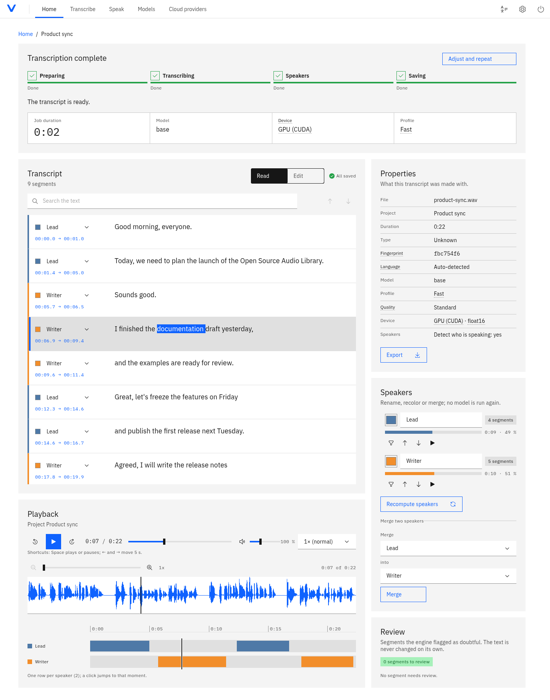
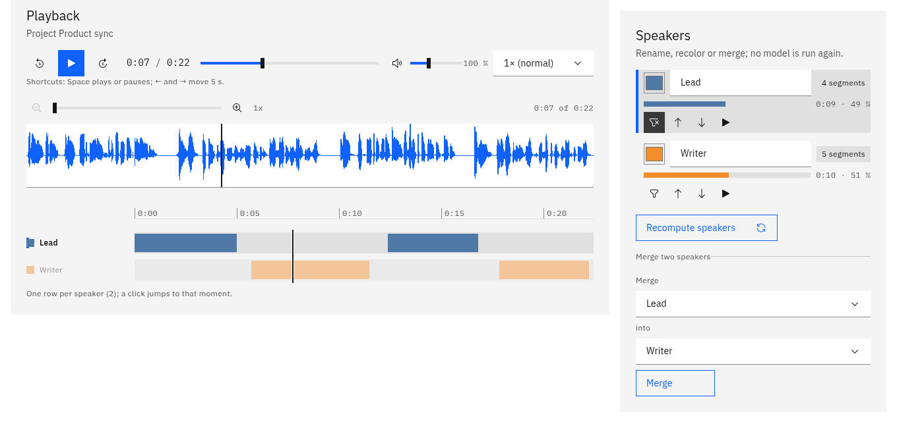
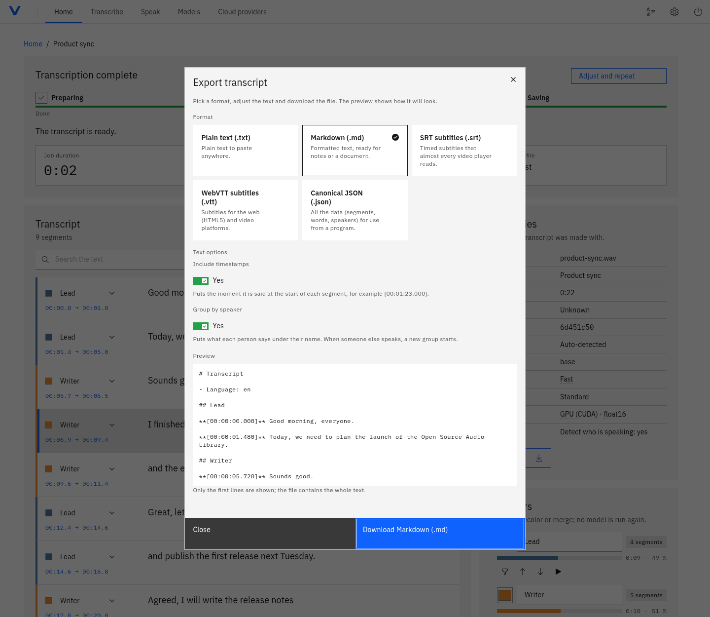
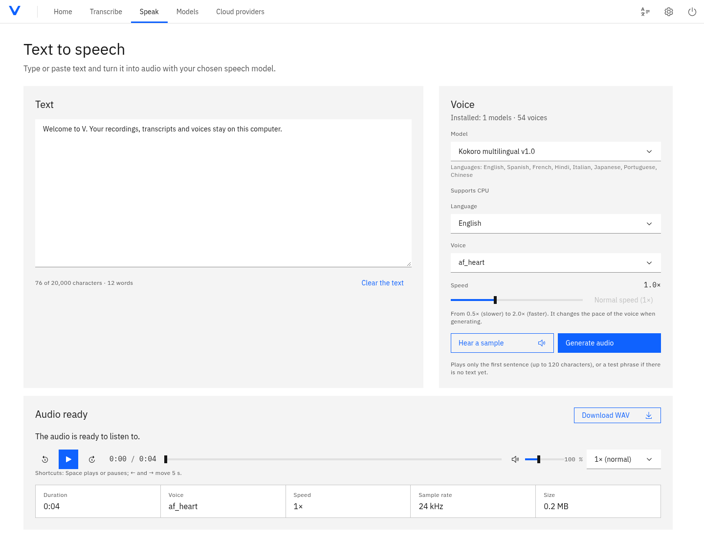
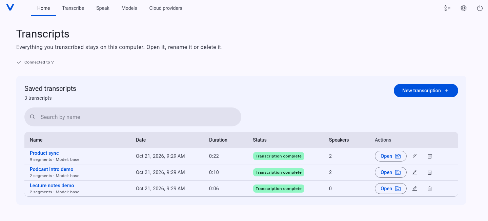
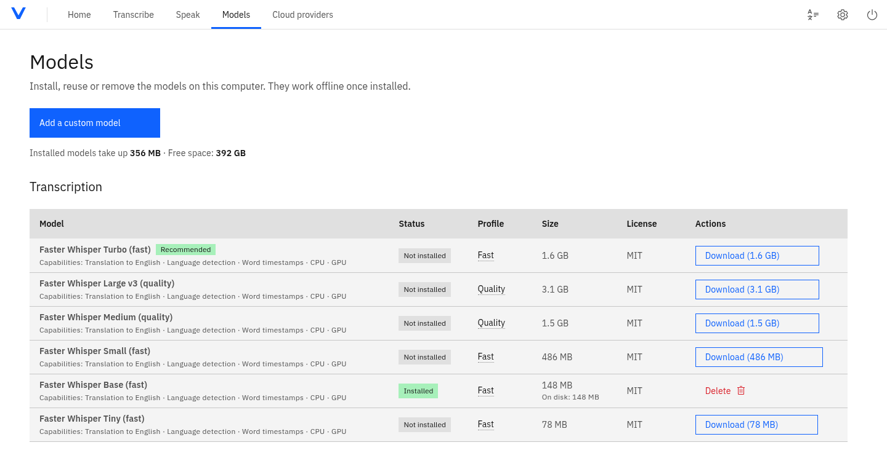
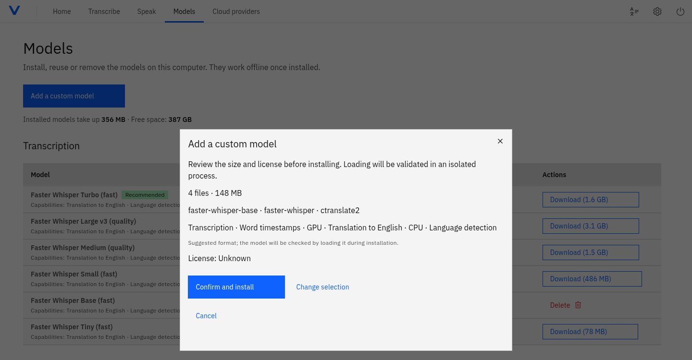

# V

**Local Voice AI**

V is a local-first application that runs speech models on your own computer.
It transcribes long recordings (classes, interviews, meetings) into editable,
speaker-labelled transcripts, and it generates speech with installed voice
models. Local processing keeps your audio on your machine by default. V is a
local web app: you start a server on your machine and use it from your browser.



> **Status:** pre-release. No version has been published or tagged; the tree
> version is `0.1.0`. Expect rough edges, and see
> [Supported platforms](#supported-platforms) for what has actually been tested.

## Quick start

1. Get the project: `git clone https://github.com/MarshallGomez1103/V.git`, or
   on GitHub choose *Code, Download ZIP* and unzip it.
2. Double-click the launcher for your system:

   | System | Launcher |
   | --- | --- |
   | Windows | `Start-V-Windows.bat` |
   | macOS | `Start-V-macOS.command` |
   | Linux | `start-v-linux.sh` |

3. Wait a few minutes on the first run; the browser opens by itself. Open
   **Models**, install one and transcribe a recording.

Only Linux has been verified by hand
([Supported platforms](#supported-platforms)). Full steps, troubleshooting and
the developer setup are under [Installation](#installation).

## Contents

- [Quick start](#quick-start)
- [What V does today](#what-v-does-today)
- [Screenshots](#screenshots)
- [Supported platforms](#supported-platforms)
- [Installation](#installation)
- [Running V](#running-v)
- [Hardware requirements](#hardware-requirements)
- [Engines and models](#engines-and-models)
- [Privacy and offline use](#privacy-and-offline-use)
- [Known limitations](#known-limitations)
- [Architecture](#architecture)
  - [Technology stack](#technology-stack)
  - [How it works](#how-it-works)
  - [Repository layout](#repository-layout)
- [Development](#development)
- [Testing](#testing)
- [Contributing](#contributing)
- [Security](#security)
- [Licensing](#licensing)
- [Roadmap](#roadmap)
- [Documentation index](#documentation-index)

## What V does today

Everything in this list exists in the repository and is covered by the project's
tests (see [CHANGELOG.md](CHANGELOG.md) and [ROADMAP.md](ROADMAP.md) for the
verified detail).

- **Local transcription** with [faster-whisper](https://github.com/SYSTRAN/faster-whisper),
  on an NVIDIA GPU when available and on the CPU otherwise. Long recordings are
  processed in chunks with SQLite checkpoints; interrupted jobs resume at
  startup and can be cancelled.
- **whisper.cpp** as an optional second local engine, when a `whisper-cli`
  binary is available ([docs/whisper-cpp.md](docs/whisper-cpp.md)).
- **Speaker diarization** with [sherpa-onnx](https://github.com/k2-fsa/sherpa-onnx)
  (no torch, no account, no token). Speakers can be renamed, recoloured and
  merged, and recomputed without re-transcribing
  ([ADR-0007](docs/adr/0007-local-diarization-sherpa-onnx.md)).
- **Speech synthesis** with installed sherpa-onnx voice models: select a model,
  language and matching voice (including Spanish, English, Portuguese and French
  with Kokoro),
  generate speech, follow progress, play the result and download a WAV. Results
  remain in a local history ([speech synthesis API](docs/api/synthesis.md)).
- **Word-level timestamps** from faster-whisper
  ([ADR-0008](docs/adr/0008-word-timestamps.md)).
- **Transcript editor**: waveform with zoom, synchronized audio player, search,
  segment editing with autosave, a speaker timeline, and a review queue for
  segments the engine flagged as doubtful. The text is never rewritten
  automatically.
- **Library**: every transcript is saved locally; open, rename or delete it
  from the home screen. Each transcript has its own permalink.
- **Export** to TXT, Markdown, SRT, VTT and canonical JSON, with a preview and
  options for timestamps and grouping by speaker.
- **Model Manager**: installs and removes models on request, adds a compatible
  model from a pasted Hugging Face or direct download link after showing its
  detected format, size and license, reuses a compatible model cache already on
  the machine (for example Buzz's), and recommends a model for your hardware.
- **Quality profiles and glossary**: reproducible profiles (`default`,
  `academic` with a silence filter), a per-project glossary, hallucination
  warnings, and `voz bench` to measure speed and error rate
  ([docs/quality-profiles.md](docs/quality-profiles.md),
  [docs/benchmarks.md](docs/benchmarks.md)).
- **Optional cloud providers (experimental)**: OpenAI and ElevenLabs Scribe, with
  your own API key, explicit consent in the interface and a cost estimate. They
  are never enabled implicitly ([docs/privacy/openai.md](docs/privacy/openai.md),
  [docs/privacy/elevenlabs.md](docs/privacy/elevenlabs.md)).
- **Installable web app (PWA)** in Chrome or Edge, a "Close server" button, and
  an optional desktop shortcut.
- **Interface**: IBM Carbon themes (light, dark, automatic, eight accent
  colours) and a Material 3 skin; English and Spanish.

## Screenshots

Real captures of the current interface on Linux, with synthetic demo audio and
local models (faster-whisper `base` on the GPU, Kokoro and speaker separation
on the CPU). [docs/demo.md](docs/demo.md) describes the data and how to
regenerate them.

| Speakers and playback | Export |
| --- | --- |
|  |  |
| **Speech generation** | **Library (Material 3 skin)** |
|  |  |

The Model Manager is shown under [Engines and models](#engines-and-models).

## Supported platforms

| Platform | Instructions and launchers | Verified |
| --- | --- | --- |
| Linux (Bazzite / Fedora Atomic, x86-64, NVIDIA RTX 4060 Laptop) | Yes | **Yes**, by hand, end to end. The only verified platform. |
| Other Linux distributions (x86-64) | Yes, generic steps | No. |
| Windows 10/11 x86-64 | Yes | No. A CI job runs the backend tests on `windows-latest`; it is not a hand test and its current result is on the Actions page. **Experimental.** |
| macOS 13 or later | Yes | No. A CI job runs the backend tests on `macos-latest`; same caveat. CPU only. **Experimental.** |

"Instructions" means the steps and launchers exist in this repository, not
that they were exercised on that system. CUDA is likewise experimental beyond
the one GPU above. If something fails on your machine, open an issue with the
output of `voz doctor --redact` (check it before posting: issues are public).

## Installation

### Double click (no programming needed)

You do not need to install Python, Node or FFmpeg yourself.

1. Get the project: run `git clone https://github.com/MarshallGomez1103/V.git`
   (or clone it with [GitHub Desktop](https://desktop.github.com)), or download
   the ZIP from GitHub (*Code, Download ZIP*) and unzip it.
2. Open the folder and double-click the launcher for your system (only the
   Linux one has been verified by hand; see
   [Supported platforms](#supported-platforms)):

   | System | Launcher |
   | --- | --- |
   | Windows | `Start-V-Windows.bat` |
   | macOS | `Start-V-macOS.command` |
   | Linux | `start-v-linux.sh` (or run `./start-v-linux.sh` in a terminal) |

3. Wait. The first run sets everything up by itself: it installs `uv`,
   downloads Python 3.12, creates the project's `.venv`, installs the
   dependencies and, if FFmpeg is not found, a pinned FFmpeg build checked by
   SHA-256. It needs an internet connection and downloads about 1.8 GB on
   Windows and Linux (mostly the NVIDIA CUDA libraries for GPU transcription)
   or about 0.3 GB on macOS; models are only downloaded when you confirm them
   in V. Later runs take seconds. The browser opens by itself. If something
   fails, the window stays open with the reason; fix it (usually the
   connection) and open the launcher again.
4. In the page, open **Models** and install one (`turbo` is recommended on a
   GPU), drop in a recording and press *Transcribe*.

Launching a second time reuses the running server and just opens another tab.
To quit, use the power button at the top right of the page.

If your system blocks the launcher ("Windows protected your PC", or macOS
refusing to open it) or the path is too long on Windows, see
[Troubleshooting](docs/troubleshooting.md).

Step-by-step guides: [Linux](docs/install/linux.md) (including installing from
a built wheel with `uv tool install`) and
[Windows and macOS](docs/install/windows-macos.md).

### From a checkout (developers)

Requires [`uv`](https://docs.astral.sh/uv/) and Python 3.12 or later (`uv` can
fetch it).

```bash
git clone https://github.com/MarshallGomez1103/V.git
cd V
uv sync --all-groups
uv run v --no-browser
```

The local engines are optional extras that install libraries, not model
weights:

```bash
uv sync --all-groups --extra asr-local      # faster-whisper (+ CUDA 12 wheels on Linux/Windows)
uv sync --all-groups --extra diarization    # sherpa-onnx speaker separation
```

## Running V

```bash
v                  # start the server and open the browser
voz                # same command; the old name stays as an alias
v --no-browser     # start without opening a browser
v doctor           # check FFmpeg, port, data paths, disk, ASR runtime and GPU (--json, --redact)
```

(From a checkout, prefix with `uv run`.) The server listens on
`http://127.0.0.1:8765` and exposes `GET /api/health`.

`v` is also the name of the V programming language compiler. If you have it
installed, another `v` may come first in your `PATH`; use `voz`, which is
unambiguous ([ADR-0009](docs/adr/0009-rename-to-v.md)).

Other options:

- `--port N` changes the port.
- `--host ADDRESS` binds to another address. Non-loopback binds require
  `--auth-token-file FILE`. Create a private credential with
  `v auth-token --output ../v-server-token.txt`; use it as a Bearer token for
  API clients, or as the password for browser username `v`. HTTP does not
  encrypt traffic. See [authentication](docs/api/authentication.md).
- `--allow-host NAME` (repeatable) adds a hostname to the accepted `Host`
  headers, for example `my-pc.local`. See
  [Troubleshooting](docs/troubleshooting.md) if you see `host_not_allowed`.

## Hardware requirements

V has been verified on one x86-64 Linux machine; Windows and macOS are
unverified (see [Supported platforms](#supported-platforms)). It needs enough
free disk for
the models (from 78 MB for `tiny` to 3.1 GB for `large-v3`), and enough RAM or
VRAM for the model you choose. An NVIDIA GPU with a working CUDA 12 driver is
optional; without one V transcribes on the CPU, which works but is slow for
long recordings.

The Model Manager recommends a faster-whisper model from the hardware it
measures (policy in
[`src/voz/application/hardware_recommendation.py`](src/voz/application/hardware_recommendation.py)):

| Detected hardware | Recommended model |
| --- | --- |
| NVIDIA GPU, 6 GiB VRAM or more | `turbo` (`large-v3` fits but is not the default) |
| NVIDIA GPU, 5 to 6 GiB VRAM | `medium` |
| NVIDIA GPU, under 5 GiB VRAM | `small` |
| CPU only, 8 GiB RAM or more | `small` |
| CPU only, under 8 GiB RAM | `base` |

These thresholds come from published CTranslate2/faster-whisper memory
requirements and from timings on one machine (RTX 4060 Laptop, 8 GiB). They
are a starting point, not a benchmark of your hardware; run `voz bench` to
measure.

## Engines and models

| Capability | Engine | Status |
| --- | --- | --- |
| Speech to text | faster-whisper (`tiny`, `base`, `small`, `medium`, `large-v3`, `turbo`) | Available |
| Speech to text | whisper.cpp (GGML models, needs a `whisper-cli` binary) | Available, optional |
| Speech to text | sherpa-onnx Whisper ONNX and NeMo transducer (custom imports, CPU) | Experimental; Parakeet v3 CPU smoke verified, Whisper ONNX real weights unverified ([details](docs/sherpa-onnx-asr.md)) |
| Speech to text | OpenAI, ElevenLabs Scribe (cloud, your API key) | Available, experimental, opt-in |
| Speaker diarization | sherpa-onnx (pyannote segmentation + WeSpeaker embeddings, ONNX) | Available |
| Text to speech | sherpa-onnx (compatible installed voice models) | Available; model families and limits in [ADR-0010](docs/adr/0010-voice-engines-and-tts.md) |
| Speech to text / text to speech | Configured OpenAI-compatible servers | Available, experimental; remote processing requires explicit selection and consent ([details](docs/api/providers.md#openai-compatible-servers-v4-04)) |

**Model downloads are explicit.** Importing or starting V downloads nothing.
A model is fetched only when you press install in the Model Manager, from a
pinned revision of its upstream repository, and every file is verified against
its size and SHA-256 before it is published; a mismatch deletes the file.
Details: [docs/models.md](docs/models.md), [docs/buzz.md](docs/buzz.md).
Model weights are not part of this repository and carry their own licenses
([Licensing](#licensing)).

To add a model that is not in the catalog, open **Models → Add a custom model**, paste a
Hugging Face repository or a direct download link and choose **Check link**.
Checking reads only metadata; V shows the detected format, download size and
license, and downloads the weights only after you confirm. The weights must
match an engine V already supports.

| Model Manager | Add a model from a link |
| --- | --- |
|  |  |

### CPU, GPU and speech languages

The model selector shows declared **CPU**, **GPU** or **CPU and GPU**
compatibility. Supporting both means one device per execution. Faster Whisper
profiles prefer a compatible NVIDIA GPU and otherwise use the CPU; the selector
shows the initial device decision and fallback reason. Loading may fall back
again, so this selection is not a measurement of the device ultimately used.
Sherpa ASR and TTS currently use the CPU; remote providers run on their server.

For speech generation, choose **Model → Language → Voice**. Kokoro multilingual
includes Spanish, English, Portuguese and French voices; each was exercised with
a short CPU synthesis sample. Piper (`es_MX-claude`, the upstream voice name)
adds a compact Spanish option and Kitten Mini adds English voices. Models are installed separately in Model
Manager; weights are not bundled. NeMo/Parakeet transcription requires **Auto**
for language and has decoding-window timestamps rather than aligned words.

See the [model comparison](docs/research/voice-models.md) for current candidates,
licenses and integration boundaries, and [measured checks](docs/benchmarks.md#additional-model-and-device-smokes-2026-10-20)
for the limits of the local CPU/GPU and multilingual checks.

## Privacy and offline use

- Everything runs locally by default. With the models already installed, V
  works with no network connection.
- The server binds to `127.0.0.1` by default. A `Host` header guard rejects requests
  for any other host name with `host_not_allowed`, as protection against DNS
  rebinding. Exposing V on a network requires `--host` and a private
  `--auth-token-file`; see [authentication](docs/api/authentication.md).
- A cloud provider is never used unless you configure it with your own key and
  select it for a job.
- Originals are immutable; derived files are stored separately. Data lives in
  the XDG directories (`~/.local/share/voz/`, `~/.cache/voz/`,
  `~/.config/voz/`), not in the source checkout. The `voz` directory names are
  kept on purpose after the rename so that existing data is not put at risk.
- Diagnostics bundles are redacted and contain no media, names or transcripts.

The rationale is in [ADR-0006](docs/adr/0006-local-first-privacy.md). Never
commit recordings, transcripts, models, databases or API keys.

## Known limitations

- **Pre-release.** No tagged version, packaged installer or published release
  exists yet. The AppImage and Flatpak recipes in [packaging/](packaging/) are
  build recipes, not published packages.
- **One verified platform.** Only the Linux machine in
  [Supported platforms](#supported-platforms) has been used end to end;
  Windows, macOS, other GPUs and single-board computers are unverified.
- **Quality is not benchmarked broadly.** Speaker separation has no measured
  diarization error rate (DER), and generated voices had no listening
  evaluation; see the limits in [Benchmarks](docs/benchmarks.md). Review
  transcripts before relying on them.
- **CPU-only engines.** sherpa-onnx transcription and speech generation run on
  the CPU. NeMo/Parakeet gives decoding-window timestamps, not aligned words,
  and Whisper ONNX has not been verified with real weights.
- **Model files are trusted input.** Checksums detect changed downloads but do
  not prove a model is harmless; import models only from publishers you trust
  ([SECURITY.md](SECURITY.md)).
- **Cloud and OpenAI-compatible providers are experimental** and send audio or
  text to that server only when you select them.

## Architecture

V is a local modular monolith with Clean/Hexagonal boundaries. The browser UI,
HTTP API and command-line interface share one Python application; use cases
and the domain remain independent of web, database and engine libraries.

### Technology stack

| Part | Technology | Role |
| --- | --- | --- |
| Frontend | React 19, TypeScript, IBM Carbon, SCSS and a Material 3 skin | Browser workspace, transcript editing, audio playback, model management and speech generation. |
| Frontend tooling | Vite 8, npm and Sass | Builds the static JavaScript/CSS bundle; provides the development server and API proxy. Node.js is needed to develop the UI, not to serve its built bundle. |
| API and server | Python 3.12+, FastAPI and Uvicorn | FastAPI defines HTTP routes and validation; Uvicorn is the ASGI server that runs the application and serves the bundled UI through FastAPI's static-file mount. |
| CLI and composition | Typer, `src/voz/bootstrap.py` | The `v` / `voz` commands start the server and run diagnostics; the composition root wires use cases, adapters and routers. |
| Application and domain | Python use cases, read models, ports and dataclasses | Job orchestration, model selection, exports and business rules, with external operations expressed as ports. |
| Persistence | SQLite, SQLAlchemy 2 and Alembic | Local project/transcript storage, durable jobs and checkpoints, and schema migrations. Media and model files use the XDG filesystem layout. |
| Audio and voice engines | FFmpeg / ffprobe, faster-whisper / CTranslate2, whisper.cpp and sherpa-onnx | Media inspection, separate inference audio, transcription, diarization and synthesis, according to the installed engine and model. Optional remote adapters require explicit configuration and selection. |
| Verification | pytest, Ruff, Pyright; Vitest, Testing Library, ESLint and TypeScript | Backend and frontend tests, formatting, lint and type checks. |

Dependency versions and optional runtimes are defined in
[pyproject.toml](pyproject.toml), [uv.lock](uv.lock),
[package.json](apps/web/package.json) and
[package-lock.json](apps/web/package-lock.json).

### How it works

```text
Browser: React UI
    | HTTP JSON / upload / audio Range; SSE job progress
Uvicorn -> FastAPI routers and response views
    | application calls
Use cases, read models and job workers -> domain rules
    | ports implemented by adapters
SQLite / filesystem / FFmpeg / selected voice engine
```

1. The Typer CLI starts Uvicorn with the app built by `create_app()` in
   `bootstrap.py`. FastAPI serves `/api/*` and the built frontend at `/`.
2. An upload creates an immutable original and its metadata. A transcription
   job records the selected engine/model and prepares a separate audio
   derivative for inference. Background workers publish durable progress and
   checkpoints; the browser follows state through Server-Sent Events (SSE).
3. The UI reads the stored transcript, streams the original for synchronized
   playback, saves edits through the API and downloads exports. Speech
   synthesis uses its own jobs and WAV results; transcription and synthesis
   share a compute slot so only one heavy job runs at a time.

Application views/read models, such as library entries and transcription
options, describe data returned by use cases. HTTP response projections such
as `interfaces/api/job_views.py` turn that data into browser-facing JSON.
These are backend data structures; the visual screens are React components.
The browser receives IDs and API fields, never host filesystem paths.

The dependency direction is
`interfaces/infrastructure -> application -> domain`; the composition root
connects concrete adapters to the ports. Processing stays local by default,
and originals remain separate from derivatives and generated speech.

### Repository layout

| Location | Contents |
| --- | --- |
| [apps/web/src/](apps/web/src/) | React UI: `components/`, typed HTTP clients in `api/`, hooks, `i18n/`, themes and styles. [apps/web/public/](apps/web/public/) holds source icons and the web manifest. |
| [src/voz/interfaces/](src/voz/interfaces/) | FastAPI transport handlers in `api/` and Typer commands in `cli/`. |
| [src/voz/application/](src/voz/application/) | Use cases, job workers, read models, exports and `ports/` for persistence, media and voice capabilities. |
| [src/voz/domain/](src/voz/domain/) | Framework-independent entities, value types and invariants. |
| [src/voz/infrastructure/](src/voz/infrastructure/) | SQLite repositories, filesystem storage, FFmpeg, voice-engine adapters and external-provider clients. |
| [src/voz/bootstrap.py](src/voz/bootstrap.py) | Composition root: constructs and connects the backend. |
| [src/voz/static/](src/voz/static/) | Generated frontend bundle shipped in the Python wheel; edited through the UI sources and rebuilt with Vite. |
| [migrations/](migrations/) | Alembic database revisions. |
| [tests/](tests/) | Backend unit, integration and provider-contract tests; frontend tests live alongside their sources in `apps/web/src/`. |
| [scripts/](scripts/) and [packaging/](packaging/) | Verification/benchmark tools and platform packaging recipes. |
| [docs/](docs/) | Architecture, API contracts, ADRs, installation and operational guides. |

Start with the [C4 architecture overview](docs/architecture/README.md), then
[ADR-0001](docs/adr/0001-modular-monolith.md). HTTP contracts are in
[docs/api/](docs/api/README.md); all decisions are in
[docs/adr/](docs/adr/README.md).

## Development

Rules for contributors, human or AI, are in [AGENTS.md](AGENTS.md). Setup for
Bazzite/Fedora Atomic is in
[docs/development/setup-bazzite.md](docs/development/setup-bazzite.md).

```bash
uv sync --all-groups
uv run v --no-browser          # backend + bundled UI at http://127.0.0.1:8765
cd apps/web
npm ci
npm run dev                    # frontend development server
```

`npm run build` regenerates the web bundle that is committed under
`src/voz/static` and ships in the wheel. Run it only when you mean to change
that bundle.

The internal Python package is still `voz`, and environment variables are
`VOZ_*`; this is intentional ([ADR-0009](docs/adr/0009-rename-to-v.md)).

## Testing

Backend:

```bash
uv run pytest
uv run ruff check .
uv run ruff format --check .
uv run pyright
```

Run a single test while iterating:

```bash
uv run pytest tests/unit/path/to/test_file.py -q
```

Frontend:

```bash
cd apps/web
npm run lint
npm run typecheck
npm run test
npm run build
```

A roadmap item is only marked done after its applicable checks have been run
and recorded.

## Contributing

V has no public release yet and no formal process for outside contributions.
The workflow the maintainers use is in [CONTRIBUTING.md](CONTRIBUTING.md); the
[Code of Conduct](CODE_OF_CONDUCT.md) applies. Read [AGENTS.md](AGENTS.md)
before changing code.

## Security

See [SECURITY.md](SECURITY.md) for scope and how to report a vulnerability.
Issues, pull requests and their attachments are public: report
vulnerabilities privately as SECURITY.md describes, never in an issue.

## Licensing

- **V's source code** is released under the [MIT license](LICENSE).
- **Third-party code** that V depends on is listed with its licenses in
  [NOTICE](NOTICE).
- **Model weights** are not shipped or redistributed by V. You download them
  from their publishers and are bound by each publisher's license, summarized
  per model in [docs/licenses/models.md](docs/licenses/models.md). That file
  also says which licenses have not been verified. The MIT license of the code
  does not cover any model.

## Roadmap

The authoritative list of what exists, with stable IDs and verifiable status, is
[ROADMAP.md](ROADMAP.md) (currently written in Spanish; translation is part of
the ongoing work). Everything below is **planned and does not exist yet**:

- A public release, with packaged installers.

Plans can change; do not rely on any of this until it appears in the
[CHANGELOG](CHANGELOG.md).

## Documentation index

- [Local OpenAI-compatible audio API](docs/api/openai-compat.md)
- [Web asset budgets and browser checks](docs/web-quality.md)
- [Troubleshooting](docs/troubleshooting.md)
- Install: [Linux](docs/install/linux.md), [Windows and macOS](docs/install/windows-macos.md)
- [Models: download, import and removal](docs/models.md), [Buzz cache reuse](docs/buzz.md)
- [Experimental Whisper ONNX](docs/sherpa-onnx-asr.md)
- [whisper.cpp](docs/whisper-cpp.md), [Quality profiles](docs/quality-profiles.md), [Benchmarks](docs/benchmarks.md)
- [Diagnostics](docs/diagnostics.md), [Robustness](docs/robustness.md), [Release and versioning](docs/release.md)
- [HTTP API](docs/api/README.md), [Architecture](docs/architecture/README.md), [ADRs](docs/adr/README.md)
- [Model and dependency licenses](docs/licenses/models.md), [Changelog](CHANGELOG.md)
