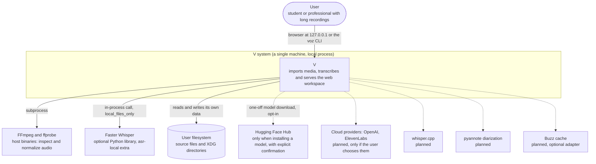

# C4 level 1: system context

Roadmap: S16.09. Code state verified against `src/voz/bootstrap.py`,
`src/voz/interfaces/cli/main.py` and `src/voz/infrastructure/`.

V (formerly VOZ) is a local-first application: a person imports audio or video
from their own disk, starts a transcription and reads the result in the
browser. Everything happens on their machine; there is no account, no remote
server and no telemetry.

## Actors

| Actor | Real interaction today |
| --- | --- |
| User | Runs `voz` (opens `http://127.0.0.1:8765` in the browser unless `--no-browser` is given) or `voz doctor` to diagnose. See `src/voz/interfaces/cli/main.py`. |

There are no other actors: there are no multiple users, roles or
authentication ([SECURITY.md](../../SECURITY.md) describes the local security
scope).

## External systems

| System | Use today | When it touches the network |
| --- | --- | --- |
| FFmpeg and ffprobe | `FfprobeMediaProbe` and `FfmpegMediaNormalizer` (`src/voz/infrastructure/audio/`) invoke them as subprocesses. `voz doctor` checks that they are present. | Never. |
| Faster Whisper | The only real provider: `FasterWhisperProvider` (`src/voz/infrastructure/asr/faster_whisper.py`). It is an optional extra in `pyproject.toml`; without it the basic startup works but transcription is not possible. | Never while transcribing: it is built with `local_files_only=True`. |
| Hugging Face Hub | `FileSystemModelStore.install` (`src/voz/infrastructure/model_storage.py`) uses `huggingface_hub.snapshot_download` with a pinned revision and explicit confirmation. No HTTP endpoint or CLI command invokes it today (verified with `grep`): it is an infrastructure API ready for the Model Manager (Section 8). | Only during an explicit installation. |
| Filesystem | Originals, derivatives, database, temporary caches. Layout in [ADR-0002](../adr/0002-sqlite-persistence.md). | Not applicable. |

## Planned (not in the code)

- Cloud providers (OpenAI, ElevenLabs): Sections 11 (OpenAI) and 12
  (ElevenLabs) of the [ROADMAP](../../ROADMAP.md). They must be opt-in under the
  rule in [ADR-0006](../adr/0006-local-first-privacy.md).
- whisper.cpp, WhisperX/alignment and pyannote diarization: Sections 6, 7
  and 9.
- Optional Buzz cache adapter: [ADR-0001](../adr/0001-modular-monolith.md)
  allows it; there is no code.

## Next level

[C4-2 Containers](02-contenedores.md).
