# C4 level 1: system context

Roadmap: S16.09. Code state verified against `src/voz/bootstrap.py`,
`src/voz/interfaces/cli/main.py` and `src/voz/infrastructure/` (2026-10).

V is a local-first voice workspace: a person imports audio or video from their
own disk, transcribes it with a model that runs on their machine, edits and
exports the result, and can also synthesize speech from text. Everything
happens on that machine by default. There is no account, no hosted server and no
telemetry. Cloud providers exist but are reached only when the person selects
one for a job and consents (see [ADR-0006](../adr/0006-local-first-privacy.md)).

```mermaid
flowchart TB
    usuario(["User<br/>student or professional with long recordings"])
    cliente(["OpenAI-compatible client<br/>scripts or tools that call /v1"])

    subgraph voz_sys["V system (a single machine, local process)"]
        voz["V<br/>imports media, transcribes, edits, exports,<br/>synthesizes speech and serves the web workspace"]
    end

    ffmpeg["FFmpeg and ffprobe<br/>host binaries: inspect and normalize audio"]
    fw["Faster Whisper<br/>optional Python library, asr-local extra"]
    wcpp["whisper.cpp (whisper-cli)<br/>optional host binary"]
    sherpa["sherpa-onnx<br/>optional Python library: ASR, diarization, TTS"]
    buzz["Buzz model cache<br/>optional read-only source for importing models"]
    fs[("User filesystem<br/>source files and XDG directories")]
    shortcut["Desktop environment<br/>optional launcher shortcut"]

    hf["Model hosts: Hugging Face, GitHub releases<br/>only to install a model, on request"]
    ffdl["FFmpeg build host (GitHub)<br/>only if ffmpeg is missing, pinned and SHA-256 checked"]
    cloud["Cloud providers: OpenAI, ElevenLabs,<br/>user-declared non-loopback endpoints<br/>per job, with explicit consent"]
    llm["Local OpenAI-compatible server<br/>user-declared loopback endpoint"]

    live["Live (microphone) transcription<br/>planned, not in the code"]
    mcp["MCP server for coding assistants<br/>planned, not in the code"]

    usuario -->|"browser at 127.0.0.1, or the v CLI"| voz
    cliente -->|"HTTP /v1/audio/*"| voz
    voz -->|"subprocess"| ffmpeg
    voz -->|"in-process call, local files only"| fw
    voz -->|"child process"| wcpp
    voz -->|"isolated worker processes"| sherpa
    voz -->|"reads and writes its own data"| fs
    voz -->|"reads candidates, copies on import"| buzz
    voz ==>|"opt-in one-off download"| hf
    voz ==>|"first start without ffmpeg"| ffdl
    voz ==>|"opt-in per job"| cloud
    voz -->|"HTTP to the declared loopback endpoint"| llm
    voz -->|"subprocess"| shortcut

    voz -.-> live
    mcp -.-> voz
```

Legend: a solid line exists in the code; a thick line is network access that
happens only when the person asks for it; a dashed line and a box labelled
"planned" are not in the code (see the [conventions](README.md#conventions)).

## Actors

| Actor | Real interaction today |
| --- | --- |
| User | Runs `v` (alias `voz`), which serves the workspace on `127.0.0.1:8765` and opens the browser unless `--no-browser` is given (`src/voz/interfaces/cli/main.py`). Also `v doctor`, `v bench`, `v lab` and `v auth-token`. The scripts are declared in `pyproject.toml`. |
| OpenAI-compatible client | Any program that speaks the `/v1` subset: `GET /v1/models`, `POST /v1/audio/transcriptions`, `POST /v1/audio/speech` (`src/voz/interfaces/api/openai_compat.py`, mounted at `src/voz/bootstrap.py`). |

There are no accounts, roles or multiple users. Authentication is a single
optional shared token (`ServerAuthMiddleware`, `src/voz/bootstrap.py`), required
for any non-loopback bind (`src/voz/interfaces/cli/main.py`). See
[SECURITY.md](../../SECURITY.md) and [docs/api/authentication.md](../api/authentication.md).

## External systems

| System | Use today | When it touches the network |
| --- | --- | --- |
| FFmpeg and ffprobe | `FfprobeMediaProbe` and `FfmpegMediaNormalizer` run them as subprocesses (`src/voz/bootstrap.py`); so does the waveform extractor (`FfmpegWaveformPeaks`). | Only `ensure_ffmpeg` (`src/voz/infrastructure/audio/ffmpeg_tools.py`), called by the CLI at startup (`src/voz/interfaces/cli/main.py`), downloads a pinned build when neither binary is on `PATH`; `VOZ_FFMPEG_AUTO_DOWNLOAD` opts out. |
| Faster Whisper | Local ASR in process; the default engine (`src/voz/bootstrap.py`). Optional `asr-local` extra. | Never while transcribing: weights are opened with `local_files_only=True` (`src/voz/infrastructure/asr/faster_whisper.py`). |
| whisper.cpp | Second local ASR engine, a `whisper-cli` child process (`src/voz/infrastructure/asr/whisper_cpp.py`). | Never. Offered only when the binary is found (`src/voz/bootstrap.py`). |
| sherpa-onnx | ASR (`src/voz/infrastructure/asr/sherpa_onnx.py`), speaker diarization (`src/voz/infrastructure/diarization/sherpa.py`) and TTS (`src/voz/infrastructure/tts/sherpa_provider.py`), each in its own worker process. Optional extra. | Never at run time. |
| Model hosts | `FileSystemModelStore` downloads pinned Faster Whisper and whisper.cpp files from Hugging Face (`src/voz/infrastructure/model_storage.py`); diarization and TTS archives come from GitHub releases (`src/voz/infrastructure/tts/catalog.py`, `src/voz/infrastructure/diarization/models.py`). Triggered from the Model Manager through `ModelTaskRunner` (`src/voz/bootstrap.py`). | Only during an install the person starts, with checksums verified. |
| Cloud providers | OpenAI and ElevenLabs transcription, and user-declared non-loopback OpenAI-compatible endpoints (`src/voz/bootstrap.py`). Keys live in the config directory (`ProviderSecrets`). | Only for a job whose creation request carries `cloud_consent: true`; never a fallback, never recommended. |
| Local OpenAI-compatible server | A loopback endpoint the person declares in Settings is treated as local (`LOCAL_PROVIDER_ID`, `src/voz/infrastructure/cloud/openai_compatible.py`) for both transcription and speech. | Loopback only. |
| Buzz cache | `BuzzModelCache` lists Buzz's installed models so they can be imported (`src/voz/bootstrap.py`). | Never. |
| Desktop environment | `LocalDesktopShortcut` refreshes an existing launcher shortcut at startup (`src/voz/bootstrap.py`). | Never. |
| Filesystem | Originals, derivatives, database, caches. Layout in [ADR-0002](../adr/0002-sqlite-persistence.md). | Not applicable. |

## Planned (not in the code)

- Live transcription from the microphone: gated by an unwritten real-time ADR;
  see the amendment of [ADR-0005](../adr/0005-transcription-providers.md).
- An MCP server for coding assistants, nested project folders, model-catalog
  filters and transcript verification: proposed in
  [ADR-0012](../adr/0012-project-folders.md),
  [ADR-0013](../adr/0013-model-catalog-filters.md) and
  [ADR-0014](../adr/0014-mcp-and-transcript-verification.md); none is accepted.

## Next level

[C4-2 Containers](02-contenedores.md).
