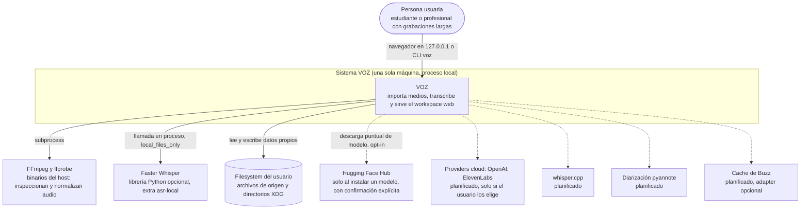

# C4 nivel 1: contexto del sistema

Roadmap: S16.09. Estado del código verificado contra `src/voz/bootstrap.py`,
`src/voz/interfaces/cli/main.py` y `src/voz/infrastructure/`.

VOZ es una aplicación local-first: una persona importa audio o video desde su
propio disco, lanza una transcripción y lee el resultado en el navegador. Todo
ocurre en su máquina; no hay cuenta, servidor remoto ni telemetría.

## Actores

| Actor | Interacción real hoy |
| --- | --- |
| Persona usuaria | Ejecuta `voz` (abre `http://127.0.0.1:8765` en el navegador salvo `--no-browser`) o `voz doctor` para diagnosticar. Ver `src/voz/interfaces/cli/main.py`. |

No hay otros actores: no existen usuarios múltiples, roles ni autenticación
([SECURITY.md](../../SECURITY.md) describe el alcance de seguridad local).

## Sistemas externos

| Sistema | Uso hoy | Cuándo toca la red |
| --- | --- | --- |
| FFmpeg y ffprobe | `FfprobeMediaProbe` y `FfmpegMediaNormalizer` (`src/voz/infrastructure/audio/`) los invocan como subprocess. `voz doctor` verifica su presencia. | Nunca. |
| Faster Whisper | Único provider real: `FasterWhisperProvider` (`src/voz/infrastructure/asr/faster_whisper.py`). Es un extra opcional de `pyproject.toml`; sin él, el arranque básico funciona pero no se puede transcribir. | Nunca al transcribir: se construye con `local_files_only=True`. |
| Hugging Face Hub | `FileSystemModelStore.install` (`src/voz/infrastructure/model_storage.py`) usa `huggingface_hub.snapshot_download` con revisión fijada y confirmación explícita. Ningún endpoint HTTP ni comando CLI la invoca hoy (verificado con `grep`): es una API de infraestructura lista para el Model Manager (Sección 8). | Solo durante una instalación explícita. |
| Filesystem | Originales, derivados, base de datos, cachés temporales. Layout en [ADR-0002](../adr/0002-sqlite-persistence.md). | No aplica. |

## Planificado (no existe en el código)

- Providers cloud (OpenAI, ElevenLabs): Secciones 11 (OpenAI) y 12 (ElevenLabs) del
  [ROADMAP](../../ROADMAP.md). Deben ser opt-in por la regla de
  [ADR-0006](../adr/0006-local-first-privacy.md).
- whisper.cpp, WhisperX/alignment y diarización pyannote: Secciones 6, 7 y 9.
- Adapter opcional de cache de Buzz: [ADR-0001](../adr/0001-modular-monolith.md)
  lo permite, no hay código.

## Siguiente nivel

[C4-2 Contenedores](02-contenedores.md).
