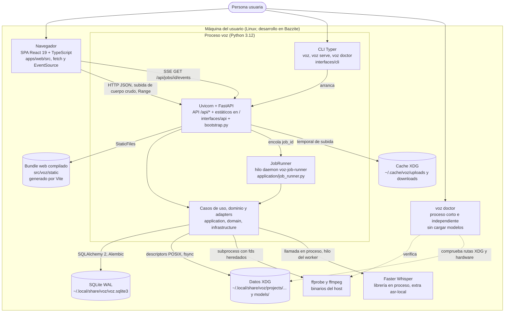

# C4 nivel 2: contenedores

Roadmap: S16.10. Verificado contra `src/voz/bootstrap.py`,
`src/voz/interfaces/cli/main.py`, `apps/web/vite.config.ts` y `pyproject.toml`.

Un «contenedor» C4 es una unidad ejecutable o un almacén de datos. VOZ es un
**monolito modular** ([ADR-0001](../adr/0001-modular-monolith.md)): un único
proceso Python contiene API, casos de uso, worker de jobs y adapters. Los demás
contenedores son el navegador, los almacenes locales y los binarios del host.

## Contenedores

| Contenedor | Tecnología y ubicación | Responsabilidad | Notas verificadas |
| --- | --- | --- | --- |
| Navegador / SPA | React 19.2 + TypeScript + Vite 8 en `apps/web/src`. | Importar, elegir opción de transcripción, seguir el job, reproducir el original y leer segmentos. | Cliente de contratos HTTP: `apps/web/src/api/*.ts` usa `fetch`, `XMLHttpRequest` (subida con progreso) y `EventSource`. Nunca recibe rutas del host. |
| Bundle web | `src/voz/static` (salida de `vite build`, `outDir: '../../src/voz/static'`). | Se sirve como estático. | Lo monta `create_app` con `StaticFiles(html=True)` en `/` solo si el directorio existe. En desarrollo `npm run dev` sirve en `127.0.0.1:5173` y hace proxy de `/api` a `127.0.0.1:8765`. |
| Proceso `voz` | `voz.interfaces.cli.main:main` (script de `pyproject.toml`). | Un proceso: Uvicorn sirve la app FastAPI de `create_app()`; un hilo daemon ejecuta los jobs. | Host por defecto `127.0.0.1`, puerto `8765`. `voz` sin subcomando equivale a `voz serve`. |
| JobRunner | Hilo `voz-job-runner`, cola FIFO en memoria (`queue.Queue`). | Un worker global avanza cada job por su máquina de estados, con cancelación cooperativa y recuperación al arrancar. | `ponytail: un worker global`. No hay cola persistente: al arrancar, `runner.recover()` reencola los jobs no terminales de SQLite. |
| `voz doctor` | `src/voz/interfaces/cli/doctor.py`. | Diagnóstico: FFmpeg, puerto, rutas XDG, disco, runtime ASR y GPU. | Salida `--json` y `--redact` (oculta rutas). No descarga ni carga modelos. |
| SQLite | Archivo `voz.sqlite3` bajo el directorio de datos XDG (`DATABASE_FILENAME` en `bootstrap.py`). | Proyectos, medios, transcripts, segmentos, jobs, checkpoints y snapshot de selección. | WAL, `foreign_keys=ON`, `busy_timeout` por conexión. Se migra con Alembic en el lifespan (`upgrade_to_head`), nunca al importar. |
| Datos XDG | `~/.local/share/voz/projects/<project>/originals/<media>.original`, `.../derivatives/<media>.inference.wav`, `models/`. | Originales inmutables, derivado PCM mono 16 kHz y modelos instalados. | Detalle en [ADR-0002](../adr/0002-sqlite-persistence.md) y [ADR-0003](../adr/0003-ffmpeg-ingestion.md). |
| Cache XDG | `~/.cache/voz/uploads` (staging de subidas) y `~/.cache/voz/downloads` (metadatos de descarga de modelos). | Temporales desechables. | El router de subida borra su directorio temporal en todos los caminos. |
| ffmpeg / ffprobe | Binarios del sistema, no vendorizados. | Inspección y normalización. | Requisito de instalación; `voz doctor` lo comprueba. |
| Faster Whisper | Extra opcional `asr-local` en `pyproject.toml`. | Único provider ASR real. | Solo se importa al construir el engine; el arranque básico no carga su runtime ni CUDA ([ADR-0004](../adr/0004-local-asr-and-recoverable-chunks.md)). |

## Protocolos entre contenedores

| Enlace | Protocolo | Contrato |
| --- | --- | --- |
| Navegador a servidor | HTTP/1.1 JSON en `127.0.0.1`; subida como cuerpo crudo `application/octet-stream` con `X-Voz-Filename`; audio con `Range`. | [docs/api/jobs.md](../api/jobs.md), [docs/api/transcription-options.md](../api/transcription-options.md). Errores `{"detail": {"code", "message"}}`. |
| Progreso de jobs | SSE (`text/event-stream`). El servidor sondea el repositorio cada ~500 ms en un hilo y emite `job` al cambiar `state`, `progress` o `updated_at`, y `: ping` cada 15 s. | `src/voz/interfaces/api/job_events.py`. No hay pub/sub en memoria ni WebSocket. |
| Servidor a worker | `queue.Queue` en proceso. | `JobRunner.enqueue`. Cancelación por `threading.Event`. |
| Núcleo a SQLite | SQLAlchemy 2 síncrono; cada operación de repository abre su conexión. | Puertos en `application/ports/repositories.py`. |
| Núcleo a FFmpeg | `subprocess` con descriptors heredados (Linux). | [ADR-0003](../adr/0003-ffmpeg-ingestion.md). |

## Ciclo de vida del proceso

1. `voz` construye `create_app()` (composition root) y arranca Uvicorn.
2. El lifespan ejecuta `upgrade_to_head`, `runner.recover()` y `runner.start()`.
3. Al apagar: `runner.stop()` deja el job en curso en un estado reanudable,
   cierra cada `LocalAsrRuntime` creado y, si el engine SQLite era propio, lo
   libera.
4. Si `--no-browser` no se indica, un hilo daemon espera `GET /api/health` y
   abre el navegador solo cuando el servidor responde `ok`.

## Fuera de alcance por diseño

Sin microservicios, Redis/RabbitMQ/Kafka, Postgres, Kubernetes, Electron ni
Tauri, salvo un ADR posterior que los autorice (regla en
[AGENTS.md](../../AGENTS.md)). Un empaquetado de escritorio está pospuesto en
[ADR-0001](../adr/0001-modular-monolith.md).

## Planificado

- Contenedor de providers cloud, whisper.cpp y diarización: sin código; ver
  [C4-1](01-contexto.md).
- Exposición LAN con opción explícita y autenticación local: hoy solo existe
  `--host`; ver [ADR-0006](../adr/0006-local-first-privacy.md).

Anterior: [C4-1 Contexto](01-contexto.md). Siguiente:
[C4-3 Componentes](03-componentes.md).
