# C4 level 2: containers

Roadmap: S16.10. Verified against `src/voz/bootstrap.py`,
`src/voz/interfaces/cli/main.py`, `apps/web/vite.config.ts` and `pyproject.toml`
(2026-10).

A C4 "container" is an executable unit or a data store. V is a
**modular monolith** ([ADR-0001](../adr/0001-modular-monolith.md)): one Python
server process holds the API, the use cases, three worker threads and the
adapters. Heavy native engines run in short-lived **child processes** started by
that server, so a native call can neither freeze the HTTP server nor outlive a
cancelled job. The other containers are the browser, the data stores and the host
binaries.

```mermaid
flowchart TB
    usuario(["User"])

    subgraph host["User machine"]
        browser["Browser<br/>React 19 + TypeScript SPA<br/>apps/web/src, fetch, XHR upload, EventSource"]

        subgraph proc["v / voz server process (Python)"]
            cli["Typer CLI<br/>v, serve, doctor, bench, lab, auth-token<br/>interfaces/cli"]
            server["Uvicorn + FastAPI<br/>/api/*, /v1/*, static files at /<br/>middleware: SecurityHeaders, HostGuard, ServerAuth"]
            jr["JobRunner thread voz-job-runner<br/>transcription and diarization jobs"]
            sr["SynthesisRunner thread voz-synthesis-runner<br/>speech synthesis jobs"]
            mt["ModelTaskRunner thread voz-model-tasks<br/>model downloads and imports"]
            slot["ComputeSlot + AdmissionGate<br/>one heavy job at a time, in memory"]
            core["Use cases, domain and adapters<br/>application, domain, infrastructure"]
            asr["Faster Whisper<br/>in-process library, resident runtime<br/>released after 60 s idle"]
        end

        subgraph kids["Child processes, one per call"]
            w_asr["sherpa-onnx ASR worker"]
            w_dia["diarization worker"]
            w_tts["TTS worker"]
            w_val["custom model validator"]
            wcpp["whisper-cli (whisper.cpp)"]
            ff["ffmpeg and ffprobe"]
        end

        lab["v lab worker<br/>edge_lab_worker, CLI only<br/>CPU and memory limits"]
        doctor["v doctor / v bench<br/>short independent processes"]

        static[("Compiled web bundle<br/>src/voz/static, generated by Vite")]
        sqlite[("SQLite WAL<br/>voz.sqlite3 in the data directory<br/>backups in the state directory")]
        data[("XDG data<br/>projects/, models/, synthesis audio")]
        cache[("XDG cache<br/>uploads, downloads, custom-model-uploads")]
        config[("XDG config<br/>provider keys, declared endpoints")]
        state[("XDG state<br/>instance.lock, database backups")]
    end

    usuario --> browser
    usuario --> cli
    usuario --> doctor

    cli -->|"starts"| server
    cli -->|"v lab"| lab
    browser -->|"HTTP JSON, raw-body upload, Range"| server
    browser -->|"SSE jobs/id/events, synthesis/id/events"| server
    server -->|"StaticFiles, only if the directory exists"| static
    server --> core
    server -->|"enqueues job id"| jr
    server -->|"enqueues job id"| sr
    server -->|"enqueues task"| mt
    jr --> slot
    sr --> slot
    jr --> core
    sr --> core
    core -->|"in-process call"| asr
    core -->|"stdin and stdout pipes"| w_asr
    core --> w_dia
    core --> w_tts
    core --> w_val
    core -->|"argv, exit code"| wcpp
    core -->|"subprocess"| ff

    core -->|"SQLAlchemy 2, Alembic"| sqlite
    core -->|"descriptors, fsync"| data
    server -->|"upload staging"| cache
    server -->|"advisory instance lock, taken first"| state
    cli -->|"early check before starting"| state
    core -->|"reads and writes"| config
    doctor -->|"checks"| ff
    doctor -->|"checks paths and hardware"| data
```

## Containers

| Container | Technology and location | Responsibility | Verified notes |
| --- | --- | --- | --- |
| Browser / SPA | React 19.2 + TypeScript + Vite 8 + Carbon in `apps/web/src`. | Library, import, transcription options, job screen, segment editing, speakers, export, model manager, speech synthesis and settings. | Uses `fetch`, `XMLHttpRequest` (upload with progress) and `EventSource` (`apps/web/src/api/jobEvents.ts`, `apps/web/src/api/media.ts`, `apps/web/src/api/synthesis.ts`). It never receives host paths. |
| Web bundle | `src/voz/static` (output of `vite build`, `outDir: '../../src/voz/static'`). | Served as static files. | Mounted at `/` with `StaticFiles(html=True)` only if the directory exists (`src/voz/bootstrap.py`); a source checkout without a build serves the API alone. `npm run dev` serves on `127.0.0.1:5186` and proxies `/api` to `127.0.0.1:8778` (`apps/web/vite.config.ts`). |
| Server process | Console scripts `v` and `voz` -> `voz.interfaces.cli.main:main` (`pyproject.toml`). | One process: Uvicorn serves the app built by `create_app()` (`src/voz/interfaces/cli/main.py`) and the worker threads run in it. | Default host `127.0.0.1`, port `8765`. `v` without a subcommand is `v serve`. A second launch that finds the server ready reuses it (`src/voz/interfaces/cli/main.py`). |
| Middleware | `SecurityHeadersMiddleware`, `HostGuardMiddleware`, `ServerAuthMiddleware` (added in `create_app`, `src/voz/bootstrap.py`). | Outermost to innermost: security headers, `Host` allowlist and cross-origin write refusal, optional shared-token authentication. | `ServerAuthMiddleware` does nothing unless a token is given; a non-loopback bind requires one (`src/voz/interfaces/cli/main.py`). |
| JobRunner | Thread `voz-job-runner`, in-memory FIFO `queue.Queue` (`src/voz/application/job_runner.py`). | Advances transcription and diarization jobs through their state machine, with cooperative cancellation and recovery. | `runner.recover()` re-enqueues non-terminal jobs at startup (`Lifespan`, `src/voz/bootstrap.py`); a cloud job interrupted by a restart is failed instead (ADR-0006). |
| SynthesisRunner | Thread `voz-synthesis-runner` (`src/voz/application/synthesis/runner.py`). | Same pattern for speech synthesis jobs. | Recovered and started with the runner (`src/voz/bootstrap.py`). |
| ModelTaskRunner | Thread `voz-model-tasks` (`src/voz/application/model_tasks.py`). | Downloads and imports models without blocking requests; progress by polling. | Started and stopped by the lifespan (`src/voz/bootstrap.py`). |
| ComputeSlot and AdmissionGate | In-memory, process-wide (`src/voz/application/compute_slot.py`, `src/voz/application/admission.py`; created in `create_app`, `src/voz/bootstrap.py`). | The slot is a fair FIFO mutex so ASR, diarization, synthesis and custom-model validation never overlap; the gate serializes check-then-act on active jobs. | They live in one process, and the instance lock keeps it to one server per data directory: a second process on the same data is refused, so nothing needs to share them. |
| Instance lock | `InstanceLock` (`src/voz/infrastructure/instance_lock.py`), file `instance.lock` in the state directory. | An OS advisory lock: at most one server per data directory. The kernel drops it when the holder dies, so there is no stale lock. | Taken in the lifespan before anything that writes (`Lifespan` in `src/voz/bootstrap.py`); a second server fails with `instance_already_running`. The CLI checks it before starting (`src/voz/interfaces/cli/main.py`). |
| Faster Whisper runtime | `SingleRuntimeCache` of `LocalAsrRuntime` (`create_app`, `src/voz/bootstrap.py`). | One resident local model; another model closes it first. | Released after `ASR_IDLE_SECONDS = 60` (`src/voz/bootstrap.py`). |
| Child processes | Started with `subprocess.Popen` and a minimal environment (`child_environment`). | sherpa ASR (`src/voz/infrastructure/asr/sherpa_onnx.py`), diarization (`src/voz/infrastructure/diarization/sherpa.py`), TTS (`src/voz/infrastructure/tts/subprocess_provider.py`), custom model validation (`src/voz/infrastructure/custom_model_worker.py`), whisper.cpp (`src/voz/infrastructure/asr/whisper_cpp.py`), ffmpeg (`src/voz/infrastructure/audio/ffmpeg.py`) and ffprobe (`src/voz/infrastructure/audio/ffprobe.py`). | Each call owns its process group; cancelling kills the tree (`src/voz/infrastructure/process_tree.py`). |
| Edge Lab worker | `voz.infrastructure.edge_lab_worker`, spawned by `ConstrainedProcess` (`src/voz/infrastructure/constrained_process.py`). | Measures installed models under child-only CPU and memory limits ([ADR-0011](../adr/0011-edge-lab.md)). | Reached only from `v lab` (`src/voz/interfaces/cli/main.py`); the server does not start it. |
| `v doctor` / `v bench` | `src/voz/interfaces/cli/doctor.py`, `src/voz/interfaces/cli/bench.py` (`main.py`). | Diagnostics and local benchmarks. | Do not load models in the server; `bench` loads one only on request. |
| SQLite | `voz.sqlite3` in the data directory (`DATABASE_FILENAME`, `src/voz/bootstrap.py`). | Projects, media, transcripts, segments, speakers, jobs, checkpoints, selections, glossaries and synthesis history. | WAL, `foreign_keys=ON` (`src/voz/infrastructure/persistence/database.py`). `upgrade_to_head` migrates at startup after a consistent backup into the state directory (`src/voz/bootstrap.py`, `src/voz/infrastructure/persistence/migrate.py`). |
| XDG data | `projects/<project>/...`, `models/` and synthesis audio (`FileSystemMediaStorage`, `FileSystemModelStore`, `FileSystemSynthesisStorage`; `src/voz/bootstrap.py`). | Immutable originals, mono 16 kHz derivatives, installed models, rendered speech. | Layout in [ADR-0002](../adr/0002-sqlite-persistence.md) and [ADR-0003](../adr/0003-ffmpeg-ingestion.md). |
| XDG cache | `uploads`, `custom-model-uploads`, `compatible-uploads` under the cache directory (`src/voz/bootstrap.py`). | Disposable staging. | Interrupted temporaries are discarded at startup (`src/voz/bootstrap.py`). |
| XDG config | Provider keys and declared endpoints (`ProviderSecrets`, `FileCompatibleEndpointStore`; `src/voz/bootstrap.py`). | Cloud keys and OpenAI-compatible endpoints, read live. | Keys never reach the browser or logs. |
| XDG state | The state directory: `instance.lock` and the pre-migration database backups (`BACKUPS_DIRECTORY`, `KEEP_BACKUPS` in `src/voz/infrastructure/persistence/migrate.py`). | Process-level state that is neither user data nor disposable cache. | Same location rules as the other XDG directories (`src/voz/infrastructure/paths.py`). |

## Protocols between containers

| Link | Protocol | Contract |
| --- | --- | --- |
| Browser to server | HTTP/1.1 JSON on `127.0.0.1`; upload as a raw `application/octet-stream` body with `X-Voz-Filename`; audio with `Range`. | [docs/api/](../api/README.md). Errors `{"detail": {"code", "message"}}`. |
| Other tools to server | `/v1/models`, `/v1/audio/transcriptions`, `/v1/audio/speech` with the OpenAI error envelope. | [docs/api/openai-compat.md](../api/openai-compat.md). |
| Job progress | SSE (`text/event-stream`) for transcription jobs and for synthesis jobs. The server polls the repository about every 500 ms and emits `job` when it changes, with `: ping` every 15 s. | `src/voz/interfaces/api/job_events.py`, `src/voz/interfaces/api/synthesis.py` (`synthesis_events`). There is no in-memory pub/sub and no WebSocket route. |
| Server to workers | In-process queues and `threading.Event` cancellation. | `JobRunner.enqueue`; the model task runner keeps its own deque. |
| Core to child processes | Arguments plus pipes or event files; no shared memory. | One module per worker under `src/voz/infrastructure/`. |
| Core to SQLite | Synchronous SQLAlchemy 2; each repository call opens its own connection. | Ports in `src/voz/application/ports/repositories.py`. |
| Core to cloud | HTTPS through `urllib_transport`, no redirects, bounded bodies; only for jobs that carry consent. | [ADR-0006](../adr/0006-local-first-privacy.md). |

## Process lifecycle

1. `v` checks the instance lock early (so a second launch fails fast, or reuses a
   server that is already ready), builds `create_app()` (the composition root)
   and starts Uvicorn.
2. The lifespan (`Lifespan` in `src/voz/bootstrap.py`) first takes the instance
   lock; if another server holds it, startup fails with `instance_already_running`.
   Then it runs `upgrade_to_head` (with a backup if the database is behind),
   discards interrupted temporaries, recovers and starts both job runners,
   refreshes an existing desktop shortcut and starts the model task runner.
3. On shutdown it stops model tasks, signals both runners, waits up to
   `WORKER_STOP_SECONDS` (10 s) in parallel, and only if both stopped closes the
   synthesis engines, the resident ASR runtime and the diarization engine; an
   engine created by the app is then disposed. The instance lock is released
   last, also when startup fails.
4. Unless `--no-browser` is given, a daemon thread waits for `GET /api/health`
   and opens the browser once the server answers `ok`.

## Out of scope by design

No microservices, Redis/RabbitMQ/Kafka, Postgres, Kubernetes, Electron or
Tauri, unless a later ADR authorizes them (rule in
[AGENTS.md](../../AGENTS.md)). A desktop package is postponed in
[ADR-0001](../adr/0001-modular-monolith.md).

## Planned (not in the code)

- Live transcription container (capture, transport and streaming engine): no
  code, no decided transport; see the amendment of
  [ADR-0005](../adr/0005-transcription-providers.md).
- MCP server process (`v mcp`, stdio): proposed in
  [ADR-0014](../adr/0014-mcp-and-transcript-verification.md). It would be a
  client of the HTTP API above, not a second job runner.
- Folders, model-catalog filters and transcript verification: proposed in
  [ADR-0012](../adr/0012-project-folders.md),
  [ADR-0013](../adr/0013-model-catalog-filters.md) and
  [ADR-0014](../adr/0014-mcp-and-transcript-verification.md).
- A server-side authentication layer beyond the shared token: none planned.

Previous: [C4-1 Context](01-contexto.md). Next:
[C4-3 Components](03-componentes.md).
