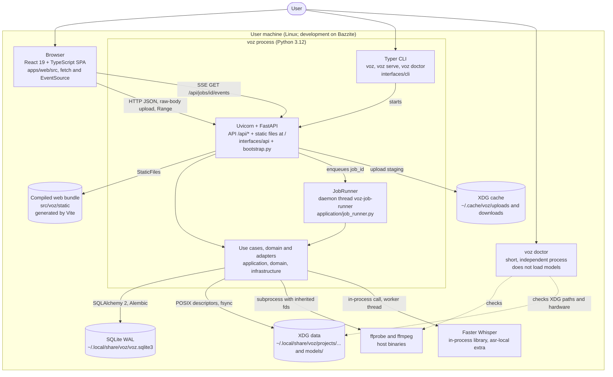

# C4 level 2: containers

Roadmap: S16.10. Verified against `src/voz/bootstrap.py`,
`src/voz/interfaces/cli/main.py`, `apps/web/vite.config.ts` and `pyproject.toml`.

A C4 "container" is an executable unit or a data store. V is a
**modular monolith** ([ADR-0001](../adr/0001-modular-monolith.md)): a single
Python process contains the API, the use cases, the job worker and the
adapters. The other containers are the browser, the local data stores and the
host binaries.

## Containers

| Container | Technology and location | Responsibility | Verified notes |
| --- | --- | --- | --- |
| Browser / SPA | React 19.2 + TypeScript + Vite 8 in `apps/web/src`. | Import, choose a transcription option, follow the job, play the original and read segments. | HTTP contract client: `apps/web/src/api/*.ts` uses `fetch`, `XMLHttpRequest` (upload with progress) and `EventSource`. It never receives host paths. |
| Web bundle | `src/voz/static` (output of `vite build`, `outDir: '../../src/voz/static'`). | Served as static files. | `create_app` mounts it with `StaticFiles(html=True)` at `/` only if the directory exists. In development `npm run dev` serves on `127.0.0.1:5173` and proxies `/api` to `127.0.0.1:8765`. |
| `voz` process | `voz.interfaces.cli.main:main` (script in `pyproject.toml`). | One process: Uvicorn serves the FastAPI app from `create_app()`; a daemon thread runs the jobs. | Default host `127.0.0.1`, port `8765`. `voz` without a subcommand is equivalent to `voz serve`. |
| JobRunner | Thread `voz-job-runner`, in-memory FIFO queue (`queue.Queue`). | A single global worker advances each job through its state machine, with cooperative cancellation and recovery at startup. | `ponytail: un worker global` (one global worker). There is no persistent queue: at startup, `runner.recover()` re-enqueues the non-terminal jobs from SQLite. |
| `voz doctor` | `src/voz/interfaces/cli/doctor.py`. | Diagnostics: FFmpeg, port, XDG paths, disk, ASR runtime and GPU. | `--json` and `--redact` output (hides paths). It neither downloads nor loads models. |
| SQLite | `voz.sqlite3` file under the XDG data directory (`DATABASE_FILENAME` in `bootstrap.py`). | Projects, media, transcripts, segments, jobs, checkpoints and selection snapshot. | WAL, `foreign_keys=ON`, per-connection `busy_timeout`. Migrated with Alembic in the lifespan (`upgrade_to_head`), never at import time. |
| XDG data | `~/.local/share/voz/projects/<project>/originals/<media>.original`, `.../derivatives/<media>.inference.wav`, `models/`. | Immutable originals, mono 16 kHz PCM derivative and installed models. | Details in [ADR-0002](../adr/0002-sqlite-persistence.md) and [ADR-0003](../adr/0003-ffmpeg-ingestion.md). |
| XDG cache | `~/.cache/voz/uploads` (upload staging) and `~/.cache/voz/downloads` (model download metadata). | Disposable temporary files. | The upload router deletes its temporary directory on every path. |
| ffmpeg / ffprobe | System binaries, not vendored. | Inspection and normalization. | Installation requirement; `voz doctor` checks it. |
| Faster Whisper | Optional `asr-local` extra in `pyproject.toml`. | The only real ASR provider. | Imported only when the engine is built; the basic startup loads neither its runtime nor CUDA ([ADR-0004](../adr/0004-local-asr-and-recoverable-chunks.md)). |

## Protocols between containers

| Link | Protocol | Contract |
| --- | --- | --- |
| Browser to server | HTTP/1.1 JSON on `127.0.0.1`; upload as a raw `application/octet-stream` body with `X-Voz-Filename`; audio with `Range`. | [docs/api/jobs.md](../api/jobs.md), [docs/api/transcription-options.md](../api/transcription-options.md). Errors `{"detail": {"code", "message"}}`. |
| Job progress | SSE (`text/event-stream`). The server polls the repository about every 500 ms in a thread and emits `job` when `state`, `progress` or `updated_at` change, and `: ping` every 15 s. | `src/voz/interfaces/api/job_events.py`. There is no in-memory pub/sub and no WebSocket. |
| Server to worker | In-process `queue.Queue`. | `JobRunner.enqueue`. Cancellation through `threading.Event`. |
| Core to SQLite | Synchronous SQLAlchemy 2; each repository operation opens its own connection. | Ports in `application/ports/repositories.py`. |
| Core to FFmpeg | `subprocess` with inherited descriptors (Linux). | [ADR-0003](../adr/0003-ffmpeg-ingestion.md). |

## Process lifecycle

1. `voz` builds `create_app()` (the composition root) and starts Uvicorn.
2. The lifespan runs `upgrade_to_head`, `runner.recover()` and
   `runner.start()`.
3. On shutdown: `runner.stop()` leaves the running job in a resumable state,
   closes every `LocalAsrRuntime` that was created and, if the SQLite engine
   was owned by the app, disposes of it.
4. Unless `--no-browser` is given, a daemon thread waits for `GET /api/health`
   and opens the browser only once the server answers `ok`.

## Out of scope by design

No microservices, Redis/RabbitMQ/Kafka, Postgres, Kubernetes, Electron or
Tauri, unless a later ADR authorizes them (rule in
[AGENTS.md](../../AGENTS.md)). A desktop package is postponed in
[ADR-0001](../adr/0001-modular-monolith.md).

## Planned

- Container for cloud providers, whisper.cpp and diarization: no code; see
  [C4-1](01-contexto.md).
- LAN exposure: `--host` (with a warning outside loopback) and `--allow-host`;
  local authentication is still planned; see [ADR-0006](../adr/0006-local-first-privacy.md).

Previous: [C4-1 Context](01-contexto.md). Next:
[C4-3 Components](03-componentes.md).
