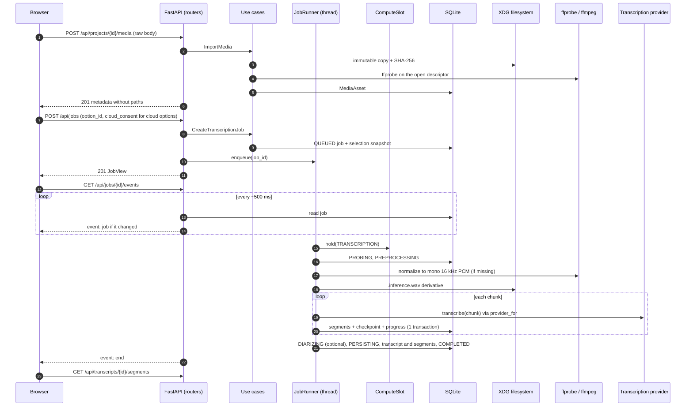

# C4 level 3: components

Roadmap: S16.11. Names and wiring verified against `src/voz/bootstrap.py` and a
`grep` over `src/voz/` and `apps/web/src/` (2026-10). Decision framework:
[ADR-0001](../adr/0001-modular-monolith.md).

The Python package and its internal names keep the technical name `voz` on
purpose ([ADR-0009](../adr/0009-rename-to-v.md)).

## Dependency rule

```text
interfaces ─┐
            ├──> application ──> domain
infrastructure ┘        (ports live in application/ports)
bootstrap.py ──> all layers (the only place that instantiates adapters)
```

Checked today: no module under `src/voz/domain` or `src/voz/application`
imports `fastapi`, `sqlalchemy`, `starlette`, `typer`, `uvicorn`,
`voz.infrastructure` or `voz.interfaces` (`grep` with no results).
Automated guards cover only the domain
(`test_domain_does_not_import_framework_or_persistence_packages`, which bans
`fastapi`, `pydantic` and `sqlalchemy`) and the provider registry
(`test_registry_has_no_domain_infrastructure_or_framework_imports`). A guard for
the whole `application` layer is **planned**; see
[ADR-0001](../adr/0001-modular-monolith.md).

## Backend component view

```mermaid
flowchart TB
    subgraph interfaces["interfaces: translate transport, no business rules"]
        cli["cli/main.py<br/>v, serve, doctor, bench, lab, auth-token"]
        mw["Middleware<br/>SecurityHeaders, HostGuard, ServerAuth"]
        r_core["Routers: health, shutdown, desktop-shortcut,<br/>transcription-options, quality-profiles"]
        r_work["Routers: projects, recordings, library, media, media_stream,<br/>waveform, jobs, transcription_queue, job_events,<br/>segments, speakers, export"]
        r_models["Routers: models, model_tasks,<br/>custom_model_uploads, providers"]
        r_voice["Routers: synthesis, openai_compat (/v1)"]
        static["StaticFiles at /<br/>only if src/voz/static exists"]
    end

    subgraph application["application: use cases and ports"]
        uc_proj["Project, glossary and library use cases"]
        uc_media["ImportMedia, NormalizeImportedMedia,<br/>PrepareInferenceAudio, GetWaveformPeaks"]
        uc_job["GetTranscriptionOptions, CreateTranscriptionJob,<br/>RediarizeTranscript, EstimateCloudTranscription"]
        uc_queue["ListRecordings, CreateTranscriptionQueue,<br/>GetTranscriptionQueue, CancelTranscriptionQueue"]
        runner["JobRunner<br/>RecoverableTranscription, AssignSpeakers"]
        uc_edit["EditSegmentText, speaker use cases, ExportTranscript"]
        uc_models["ListModels, RemoveModel, ModelTaskRunner,<br/>ImportExternalModel, ImportCustomModel"]
        uc_voice["CreateSynthesisJob, SynthesisRunner,<br/>history and delete, LocalCompatibleAudioService"]
        gates["ComputeSlot, AdmissionGate"]
        regs["TranscriptionProviderRegistry,<br/>SynthesisProviderRegistry"]
        ports["application/ports<br/>repositories, storage, probes, providers,<br/>model installation, secrets, endpoints"]
    end

    subgraph domain["domain: pure entities and invariants"]
        ent["Project, MediaAsset, Transcript, Segment, Word,<br/>Speaker, SpeakerTurn, TranscriptionJob,<br/>TranscriptionQueue, SynthesisJob, SynthesizedAudio"]
        mdl["ModelDescriptor, ProcessingProfile, QualityProfile, Voice"]
    end

    subgraph infra["infrastructure: adapters"]
        sql["persistence/<br/>Sqlite repositories, checkpoints,<br/>selections, queues, glossaries, library, synthesis, migrate"]
        files["FileSystemMediaStorage, FileSystemInferenceAudioSource,<br/>FileSystemSynthesisStorage, ShutilDiskSpace"]
        av["FfprobeMediaProbe, FfmpegMediaNormalizer,<br/>FfmpegWaveformPeaks"]
        asr["asr/: FasterWhisperProvider, WhisperCppProvider,<br/>SherpaOnnxProvider, catalogs, probes"]
        dia["diarization/: SherpaOnnxDiarizationProvider,<br/>DiarizationModelStore"]
        tts["tts/: SubprocessSynthesisProvider,<br/>TtsModelStore, installed models"]
        cloud["cloud/: OpenAI, ElevenLabs,<br/>OpenAI-compatible, endpoint store"]
        models["FileSystemModelStore, CustomModelStore,<br/>ManagedModelCatalog, RoutingModelStore, BuzzModelCache"]
        misc["ProviderSecrets, LocalDesktopShortcut,<br/>paths.py, child_env.py, process_tree.py"]
    end

    boot["bootstrap.py<br/>create_app, create_local_asr_runtime<br/>composition root"]

    cli --> boot
    boot ==>|"instantiates and wires"| infra
    boot ==>|"builds use cases"| application
    boot ==>|"injects into routers, adds middleware"| interfaces

    mw --> r_core
    r_work --> uc_proj
    r_work --> uc_media
    r_work --> uc_job
    r_work --> uc_queue
    r_work --> runner
    r_work --> uc_edit
    r_models --> uc_models
    r_voice --> uc_voice
    r_voice --> uc_job

    runner --> gates
    uc_voice --> gates
    runner --> regs
    uc_voice --> regs
    uc_proj --> ports
    uc_media --> ports
    uc_job --> ports
    uc_queue --> ports
    runner --> ports
    uc_edit --> ports
    uc_models --> ports
    uc_voice --> ports
    application --> domain

    sql -->|"implements"| ports
    files -->|"implements"| ports
    av -->|"implements"| ports
    asr -->|"implements"| ports
    dia -->|"implements"| ports
    tts -->|"implements"| ports
    cloud -->|"implements"| ports
    models -->|"implements"| ports
    misc -->|"implements"| ports
```



> The arrows from `bootstrap.py` to whole layers summarize dozens of
> constructors; the exact detail is `create_app()` and
> `create_local_asr_runtime()` in `src/voz/bootstrap.py`.

## Mounted routers

`create_app()` adds the routers in this order, all under `/api` except the
OpenAI-compatible one. Every router is mounted unconditionally; the only
conditional mounts are the static bundle and some optional arguments noted
below.

| Router | Factory | Order in `create_app` (`src/voz/bootstrap.py`) | Notes |
| --- | --- | --- | --- |
| health | `src/voz/interfaces/api/health.py` (module router) | 1 | `GET /api/health`. |
| shutdown | `create_shutdown_router`, `shutdown.py` | 2 | `POST /api/shutdown` answers 501 `shutdown_unavailable` when the app was not started by the CLI (`request_shutdown` is `None`). |
| desktop shortcut | `desktop_shortcut.py` | 3 | |
| transcription options | `transcription_options.py` | 4 | Options depend on the catalogs built earlier in `create_app`; whisper.cpp options only if `whisper-cli` is found. |
| projects and glossary | `projects.py` | 5 | Rename, delete and glossary routes exist only when their use case is passed; the composition root always passes them. |
| recordings | `recordings.py` | 6 | `GET /api/projects/{project_id}/recordings`. |
| library | `library.py` | 7 | |
| quality profiles | `quality_profiles.py` | 8 | |
| media upload | `media.py` | 9 | Raw-body upload staged in the cache directory. |
| jobs | `jobs.py` | 10 | Re-diarization route only when `rediarize` is passed (always). |
| transcription queue | `transcription_queue.py` | 11 | Start, read and cancel a project queue ([API](../api/transcription-queue.md)). |
| job events (SSE) | `job_events.py` | 12 | |
| media stream | `media_stream.py` | 13 | Original with `Range`. |
| segments | `segments.py` | 14 | |
| speakers | `speakers.py` | 15 | |
| waveform | `waveform.py` | 16 | |
| models | `models.py` | 17 | Custom engines listed only if their runtime is importable (the `custom_engines` argument). |
| custom model uploads | `custom_model_uploads.py` | 18 | |
| model tasks | `model_tasks.py` | 19 | |
| providers | `providers.py` | 20 | Keys and declared endpoints. |
| export | `export.py` | 21 | |
| synthesis | `synthesis.py` | 22 | |
| OpenAI-compatible | `openai_compat.py` | 23 | Prefix `/v1`. |
| static bundle | `StaticFiles` | 24 | Only `if STATIC_DIRECTORY.is_dir()`. |

## Components by layer

### `domain` (`src/voz/domain/entities/`)

Immutable dataclasses with validation in `__post_init__` and no framework
imports.

| Component | File |
| --- | --- |
| `Project`, `MediaAsset`, `Transcript`, `Segment`, `Word`, `Speaker`, `SpeakerTurn` | `project.py`, `media_asset.py`, `transcript.py`, `segment.py`, `word.py`, `speaker.py`, `speaker_turn.py` |
| `TranscriptionJob`, `TranscriptionJobState` (validated transitions) | `transcription_job.py` |
| `TranscriptionQueue`, `QueueItemStatus`, `QueueState`, `SkippedRecording`, `SkipReason` (status derived from the jobs; no state of its own) | `transcription_queue.py` |
| `SynthesisJob`, `SynthesisRequest`, `SynthesizedAudio`, `Voice` | `synthesis_job.py`, `synthesis_request.py`, `synthesized_audio.py`, `voice.py` |
| `ModelDescriptor`, `ModelCapability` | `model_descriptor.py` |
| `ProcessingProfile`, `ProcessingProfileName`, `DevicePreference`, `ComputePrecision` | `processing_profile.py` |
| `QualityProfile` | `quality_profile.py` |

### `application` (`src/voz/application/`)

| Component | File | Role |
| --- | --- | --- |
| `CreateProject`, `ListProjects`, `RenameProject`, `DeleteProject` | `projects.py` | Project use cases; delete refuses while a job is active. |
| `ProjectGlossary` | `project_glossary.py` | Per-project vocabulary hints. |
| `ListLibrary` | `library.py` | One summary row per project. |
| `ImportMedia` | `import_media.py` | Immutable copy, hash, probe, persistence of the `MediaAsset`. |
| `ListRecordings` | `list_recordings.py` | The recordings of one project with the latest job of each. |
| `NormalizeImportedMedia`, `PrepareInferenceAudio` | `normalize_media.py`, `prepare_inference_audio.py` | Mono 16 kHz PCM derivative by identity, no paths. |
| `GetWaveformPeaks` | `waveform_peaks.py` | Cached waveform peaks. |
| `GetTranscriptionOptions` | `get_transcription_options.py` | Options with `can_start` and blocking reasons. |
| `CreateTranscriptionJob` | `create_transcription_job.py` | Revalidates the option, enforces cloud consent, stores the reproducible snapshot. |
| `RediarizeTranscript` | `rediarize.py` | New speaker analysis of an existing transcript. |
| `EstimateCloudTranscription` | `estimate_cloud_cost.py` | Price estimate before a cloud job. |
| `CreateTranscriptionQueue`, `GetTranscriptionQueue`, `CancelTranscriptionQueue` | `transcription_queue.py` | One ordinary job per eligible recording of a project, created in one write; read and cancel the queue. See [ADR-0015](../adr/0015-transcription-range-and-project-queue.md). |
| `JobRunner` | `job_runner.py` | One worker, explicit states, cancellation, `recover()`. |
| `RecoverableTranscription` | `recoverable_transcription.py` | One atomic checkpoint per chunk; resumes without repeating work. |
| `AssignSpeakers`, `AssignProviderSpeakers` | `assign_speakers.py` | Merge diarization or provider speakers into segments. |
| `EditSegmentText`, `ListTranscriptSpeakers`, `UpdateSpeaker`, `MergeSpeakers`, `AssignSegmentSpeaker` | `edit_segment.py`, `speakers.py` | Transcript editing. |
| `ExportTranscript` | `export/service.py` | TXT, Markdown, SRT, VTT and canonical JSON renderers over segments. |
| `ListModels`, `RemoveModel` | `model_manager.py` | Model Manager queries and removal. |
| `ModelTaskRunner` | `model_tasks.py` | Background installs and imports. |
| `ImportExternalModel`, `ImportCustomModel` | `import_external_model.py`, `import_custom_model.py` | Reuse a Buzz cache model; register a user-supplied model after validation. |
| `CreateSynthesisJob`, `SynthesisRunner`, `ListSynthesisHistory`, `DeleteSynthesisResult` | `synthesis/create_synthesis_job.py`, `synthesis/runner.py`, `synthesis/list_synthesis_history.py`, `synthesis/delete_synthesis_result.py` | Speech synthesis. |
| `LocalCompatibleAudioService` | `compatible_audio.py` | Backs `/v1/audio/*` with the same use cases. |
| `ComputeSlot`, `AdmissionGate` | `compute_slot.py`, `admission.py` | Heavy-work mutex and check-then-act gate. |
| `TranscriptionProviderRegistry`, `SynthesisProviderRegistry` | `transcription_provider_registry.py`, `synthesis_provider_registry.py` | Registries by stable id, no replacement. See [ADR-0005](../adr/0005-transcription-providers.md) and its amendment. |
| Pure helpers | `asr_device_selection.py`, `hardware_recommendation.py`, `quality_flags.py`, `evaluation.py`, `quality_profiles.py`, `text_chunking.py` | Deterministic functions. |

Ports live in `src/voz/application/ports/` (31 modules), among them
`transcription_queue.py` (`TranscriptionQueueRepository`, `JobCanceller`),
`repositories.py` (project, media, transcript, segment, word, speaker, speaker
turn and job repository protocols), `transcription.py` (`TranscriptionProvider`
and canonical types), `speech_synthesis.py`, `diarization.py`,
`model_installation.py`, `provider_secrets.py` and `compatible_endpoints.py`.

### `infrastructure` (`src/voz/infrastructure/`)

| Adapter | File | Implements or provides |
| --- | --- | --- |
| `create_sqlite_engine` | `persistence/database.py` | WAL engine with per-connection pragmas. |
| `SqliteProjectRepository`, `SqliteMediaAssetRepository`, `SqliteTranscriptRepository`, `SqliteSegmentRepository`, `SqliteSpeakerRepository`, `SqliteSpeakerTurnRepository`, `SqliteTranscriptionJobRepository` | `persistence/repositories.py` | Repository ports. Words are stored through the segment repository. |
| `SqliteTranscriptionCheckpointStore`, `SqliteTranscriptionJobSelectionRepository`, `SqliteProjectGlossaryRepository` | `persistence/transcription_checkpoints.py`, `persistence/transcription_job_selections.py`, `persistence/project_glossaries.py` | Atomic chunk commit, selection snapshot, glossaries. |
| `SqliteTranscriptionQueueRepository` | `persistence/transcription_queues.py` | Queue row, item positions and their jobs in one transaction. |
| `SqliteLibraryReader` | `persistence/library.py` | Library read model. |
| `SqliteSynthesisJobRepository`, `SqliteSynthesizedAudioRepository` | `persistence/synthesis.py` | Synthesis history. |
| `upgrade_to_head` | `persistence/migrate.py` | Programmatic Alembic with a pre-migration backup. |
| `FileSystemMediaStorage`, `FileSystemInferenceAudioSource`, `FileSystemSynthesisStorage`, `ShutilDiskSpace` | `media_storage.py`, `inference_audio.py`, `synthesis_storage.py`, `disk_space.py` | Storage ports. |
| `FfprobeMediaProbe`, `FfmpegMediaNormalizer`, `FfmpegWaveformPeaks` | `audio/ffprobe.py`, `audio/ffmpeg.py`, `audio/waveform_peaks.py` | Media ports. |
| `FasterWhisperProvider`, `FasterWhisperModelCatalog`, `LocalTranscriptionModelCatalog`, `FasterWhisperRuntimeProbe`, `CTranslate2HardwareProbe`, `SingleRuntimeCache` | `asr/faster_whisper.py`, `asr/catalog.py`, `asr/options.py`, `asr/hardware.py`, `asr/runtime_cache.py` | Default local ASR. |
| `WhisperCppProvider`, `WhisperCppTranscriptionModelCatalog`, `WhisperCppRuntimeProbe` | `asr/whisper_cpp.py`, `asr/whisper_cpp_options.py` | whisper.cpp. |
| `SherpaOnnxProvider`, `SherpaOnnxRuntimeProbe` | `asr/sherpa_onnx.py`, `asr/sherpa_onnx_options.py` | sherpa-onnx ASR in a worker process. |
| `SherpaOnnxDiarizationProvider`, `SherpaDiarizationAvailability`, `DiarizationModelStore` | `diarization/sherpa.py`, `diarization/availability.py`, `diarization/models.py` | Local speaker diarization. |
| `SubprocessSynthesisProvider` (`sherpa_tts_provider`), `TtsModelStore`, `InstalledTtsModels` | `tts/subprocess_provider.py`, `tts/sherpa_provider.py`, `tts/model_store.py`, `tts/installed_models.py` | Local speech synthesis in a worker process. |
| `OpenAITranscriptionProvider`, `ElevenLabsScribeProvider`, `CompatibleTranscriptionProvider`, `CompatibleSpeechProvider` | `cloud/openai_transcription.py`, `cloud/elevenlabs_scribe.py`, `cloud/openai_compatible.py` | Cloud and user-declared endpoints. |
| `CloudTranscriptionCatalog`, `CompositeCatalog`, `CloudRuntimeProbe`, `RoutingRuntimeProbe`, `CompatibleModels`, `CompatibleRuntimeProbe`, `HttpConnectionTester` | `cloud/catalog.py`, `cloud/openai_compatible.py` | Option catalogs and probes. |
| `ProviderSecrets`, `FileCompatibleEndpointStore` | `secrets.py`, `cloud/compatible_store.py` | Config-directory secrets and endpoints. |
| `FileSystemModelStore`, `ManagedModelCatalog`, `RoutingModelStore`, `CustomModelStore`, `CustomModelCatalog`, `SubprocessModelValidator`, `FileSystemCustomModelUpload`, `BuzzModelCache` | `model_storage.py`, `model_registry.py`, `custom_models.py`, `custom_model_worker.py`, `custom_model_upload.py`, `buzz_cache.py` | Model Manager storage and import. |
| `LocalDesktopShortcut` | `desktop_shortcut.py` | Launcher shortcut. |
| `ConstrainedProcess` | `constrained_process.py` | Edge Lab only; wired in the CLI, not in `create_app`. |
| `VozPaths`, `resolve_voz_paths` | `paths.py` | XDG data, config, cache and state paths. |

### `interfaces` (`src/voz/interfaces/`)

One router per resource; each (except `health.py`) is a `create_*_router(...)`
function that receives its already-built use cases (table above). Middleware:
`HostGuardMiddleware` (`host_guard.py`), `ServerAuthMiddleware`
(`server_auth.py`), `SecurityHeadersMiddleware` (`security_headers.py`).
The CLI lives in `cli/main.py`, `cli/doctor.py`, `cli/bench.py`, `cli/lab.py`
and `cli/diagnostics_bundle.py`.

### Composition root (`src/voz/bootstrap.py`)

`create_app()` instantiates repositories, storage, catalogs, runners
and routers; the `provider_for` closure chooses the transcription
adapter by provider id and `_local_provider` borrows the resident
Faster Whisper runtime built by `create_local_asr_runtime()`.

## Known deviations from the dependency rule

Honest and bounded; they are not violations of the `AGENTS.md` rule
(interfaces may depend on infrastructure), but they deserve attention:

- `interfaces/api/media_stream.py` receives the concrete
  `FileSystemMediaStorage` adapter and calls `original_path_for` to serve a
  `FileResponse`. The path stays on the server and is never serialized to the
  browser. A read port for originals would be cleaner.
- `interfaces/cli/doctor.py` and `interfaces/cli/bench.py` use infrastructure
  adapters directly, because they are diagnostic tools with no use case of
  their own.
- `JobRunner` and the other runners (application) use the standard library's
  `threading` and `queue`; an accepted execution detail, marked with `ponytail:`.
- `provider_for` is an `if`/`elif` chain in the composition root, not a
  registry (see the amendment of
  [ADR-0005](../adr/0005-transcription-providers.md)).

## Main flow: import, transcribe and follow progress



## Frontend (`apps/web/src/`)

Directory layout today; the per-file list is not regenerated here.

| Component | Location | Role |
| --- | --- | --- |
| Composition | `main.tsx`, `App.tsx`, `hooks/useRoute.ts` | Local screen state and a small own route hook; no router library and no global store. |
| Contract clients | `api/*.ts` (health, projects, library, media, jobs, jobEvents, segments, speakers, models, customModels, providers, synthesis, glossary, exportDocument and others) | Type the responses and translate `{"detail": {"code", "message"}}`. |
| Hooks | `hooks/` | SSE subscription, library loading and audio/segment synchronization. |
| Components | `components/` | Library, new transcription, project screen (`ProjectScreen`: a project's recordings and multi-file upload), project queue (`ProjectQueue`: start, follow and cancel "Transcribe project"), trim controls (`TrimControls`: start and end of the stretch to transcribe), job screen, segment list and review queue, audio player, export dialog, model manager, providers settings and the speech workspace (`Speak*`), built on Carbon (`@carbon/react`). |
| i18n | `i18n/` | English and Spanish message catalogs (`i18n/messages`). |
| Styles and theme | `styles/`, `theme/`, `App.scss` | Tokens, themes and SCSS. |

The frontend knows nothing about host paths, the database schema or providers:
only identifiers and contract fields. TanStack Query, Zustand and WaveSurfer.js
from the master plan are **planned**; the app uses `fetch`, `EventSource` and
the `<audio>` element.

## Planned (no code)

- Live transcription: a `StreamingTranscriptionProvider` port, session
  handling, transport and a streaming engine. See the amendment of
  [ADR-0005](../adr/0005-transcription-providers.md); transport and engine are
  undecided.
- Nested project folders ([ADR-0012](../adr/0012-project-folders.md)), model
  catalog filters ([ADR-0013](../adr/0013-model-catalog-filters.md)), the MCP
  server and transcript verification
  ([ADR-0014](../adr/0014-mcp-and-transcript-verification.md)): proposed.
- Dynamic provider discovery: forbidden until the rule in
  [ADR-0005](../adr/0005-transcription-providers.md) is met. The
  `AlignmentProvider` port exists (`src/voz/application/ports/alignment.py`)
  with no separate engine behind it.

Previous: [C4-2 Containers](02-contenedores.md). Index:
[README](README.md).
