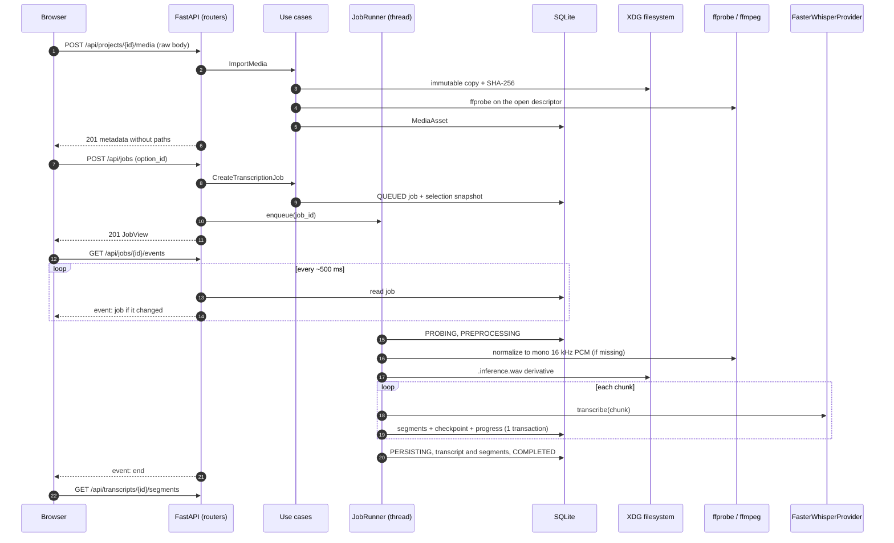

# C4 level 3: components

Roadmap: S16.11. Module and class names verified with `grep` over `src/voz/`
and `apps/web/src/` at commit `b775251` plus the working tree of wave 3.
Decision framework: [ADR-0001](../adr/0001-modular-monolith.md).

This page describes V as of that snapshot. The Python package
and its internal names keep the technical name `voz` on purpose
([ADR-0009](../adr/0009-rename-to-v.md)).

## Dependency rule

```text
interfaces ─┐
            ├──> application ──> domain
infrastructure ┘        (ports live in application/ports)
bootstrap.py ──> all layers (the only place that instantiates adapters)
```

Checked today: no module in `src/voz/domain` or `src/voz/application` imports
`fastapi`, `sqlalchemy`, `starlette`, `faster_whisper`, `typer`, `uvicorn` or
`voz.infrastructure`/`voz.interfaces` (`grep` search with no results).
Automated: only the domain
(`test_domain_does_not_import_framework_or_persistence_packages`, which bans
`fastapi`, `pydantic` and `sqlalchemy`) and the provider registry
(`test_registry_has_no_domain_infrastructure_or_framework_imports`). An
automatic guard for the whole `application` layer is **planned**; see
[ADR-0001](../adr/0001-modular-monolith.md).

## Backend component view


> The arrows from `bootstrap.py` to whole layers summarize dozens of
> constructors; the exact detail is `create_app()` and
> `create_local_asr_runtime()` in `src/voz/bootstrap.py`.

## Components by layer

### `domain` (`src/voz/domain/entities/`)

Immutable dataclasses with validation in `__post_init__` and no framework
imports.

| Component | File |
| --- | --- |
| `Project`, `MediaAsset`, `Transcript`, `Segment`, `Word`, `Speaker`, `SpeakerTurn` | `project.py`, `media_asset.py`, `transcript.py`, `segment.py`, `word.py`, `speaker.py`, `speaker_turn.py` |
| `TranscriptionJob`, `TranscriptionJobState` (12 states, validated transitions) | `transcription_job.py` |
| `ModelDescriptor`, `ModelCapability` | `model_descriptor.py` |
| `ProcessingProfile`, `ProcessingProfileName`, `DevicePreference`, `ComputePrecision` | `processing_profile.py` |

### `application` (`src/voz/application/`)

| Component | File | Role |
| --- | --- | --- |
| `CreateProject`, `ListProjects` | `projects.py` | Project use cases. |
| `ImportMedia` | `import_media.py` | Immutable copy, hash, probe and persistence of the `MediaAsset`. |
| `NormalizeImportedMedia`, `PrepareInferenceAudio` | `normalize_media.py`, `prepare_inference_audio.py` | Mono 16 kHz PCM derivative by identity, no paths. |
| `GetTranscriptionOptions` | `get_transcription_options.py` | Options with `can_start` and blocking reasons. |
| `CreateTranscriptionJob` | `create_transcription_job.py` | Revalidates the option and stores the reproducible snapshot. |
| `JobRunner` | `job_runner.py` | One worker, explicit states, cancellation, `recover()`, `transcript_id_for`. |
| `RecoverableTranscription`, chunk planning | `recoverable_transcription.py`, `chunked_transcription.py` | One atomic checkpoint per chunk; resumes without repeating work. |
| `select_execution` | `asr_device_selection.py` | Observable CPU/GPU decision and fallback reason. |
| `TranscriptionProviderRegistry` | `transcription_provider_registry.py` | Registry by stable ID, no replacement. See [ADR-0005](../adr/0005-transcription-providers.md). |
| Pure exporters (`TxtExporter`, `MarkdownExporter`, SRT, VTT, canonical JSON) | `export/` | Renderers over segments; the HTTP export wiring was work in progress in wave 3 and was not in `bootstrap.py` when this was written. |

Ports (`application/ports/`): `repositories.py` (eight repositories),
`transcription_checkpoint.py`, `transcription_job_selection.py`,
`media_storage.py`, `media_probe.py`, `media_normalization.py`,
`inference_audio.py`, `transcription.py` (`TranscriptionProvider` and canonical
types), `model_installation.py`, `transcription_options.py`.

### `infrastructure` (`src/voz/infrastructure/`)

| Adapter | File | Implements |
| --- | --- | --- |
| `create_sqlite_engine`, schema, `Sqlite*Repository` | `persistence/database.py`, `schema.py`, `repositories.py` | Eight repositories (`Sqlite*Repository`); `bootstrap.py` wires five today (project, media, transcript, segment, job), and the word, speaker and turn ones have no HTTP use. |
| `SqliteTranscriptionCheckpointStore` | `persistence/transcription_checkpoints.py` | Atomic commit of chunk, progress and job. |
| `SqliteTranscriptionJobSelectionRepository` | `persistence/transcription_job_selections.py` | Selection snapshot. |
| `upgrade_to_head` | `persistence/migrate.py` | Programmatic Alembic (`migrations/versions/`). |
| `FileSystemMediaStorage` | `media_storage.py` | `MediaStoragePort`. |
| `FfprobeMediaProbe` | `audio/ffprobe.py` | `MediaProbePort`. |
| `FfmpegMediaNormalizer` | `audio/ffmpeg.py` | `MediaNormalizationPort`. |
| `FileSystemInferenceAudioSource` | `inference_audio.py` | `InferenceAudioSource`, WAV bounded per chunk. |
| `FasterWhisperProvider` | `asr/faster_whisper.py` | `TranscriptionProvider` (the only real one). |
| `LocalTranscriptionModelCatalog`, `FasterWhisperRuntimeProbe`, `CTranslate2HardwareProbe`, `fast`/`quality` descriptors | `asr/options.py`, `asr/hardware.py`, `asr/catalog.py` | Catalog, runtime availability and hardware probing. |
| `FileSystemModelStore` | `model_storage.py` | Explicit installation and local model resolution. |
| `VozPaths`, `resolve_voz_paths` | `paths.py` | XDG paths. |

### `interfaces` (`src/voz/interfaces/`)

One router per resource. Except for `health.py` (a static router), each one is
a `create_*_router(...)` function that receives its already-built dependencies
(`api/projects.py`, `media.py`, `media_stream.py`, `transcription_options.py`,
`jobs.py`, `job_events.py`). The CLI lives in `cli/main.py` and
`cli/doctor.py`.

### Composition root (`src/voz/bootstrap.py`)

`create_app()` instantiates repositories, storage, probe, `JobRunner` and
routers; `create_local_asr_runtime()` composes Faster Whisper for an exact
descriptor (`LocalAsrRuntime`, with `close()`). `provider_for` creates one
runtime per descriptor on demand and the lifespan closes them.

## Known deviations from the dependency rule

Honest and bounded; they are not violations of the `AGENTS.md` rule
(interfaces may depend on infrastructure), but they deserve attention:

- `interfaces/api/media_stream.py` receives the concrete
  `FileSystemMediaStorage` adapter and calls `original_path_for` to serve a
  `FileResponse`. The path stays on the server: it is never serialized to the
  browser (test `test_deleted_original_file_is_reported_missing_without_path`).
  A read port for originals would be cleaner; it is not planned as a roadmap
  item.
- `interfaces/cli/doctor.py` uses `CTranslate2HardwareProbe`,
  `FasterWhisperRuntimeProbe` and `resolve_voz_paths` directly, because it is
  a diagnostic tool with no use case of its own.
- `JobRunner` (application) uses the standard library's `threading` and
  `queue`; this is an accepted execution detail, marked with `ponytail:`.

## Main flow: import, transcribe and follow progress



## Frontend (`apps/web/src/`)

This table is the snapshot described at the top of the page. Since then the
frontend has grown (for example, UI text now goes through `apps/web/src/i18n`
in Spanish and English, and styles are SCSS); the table below is not
regenerated here.

| Component | Files | Role |
| --- | --- | --- |
| Composition | `main.tsx`, `App.tsx` | Local screen state; no global store and no router. |
| Contract clients | `api/health.ts`, `projects.ts`, `media.ts`, `transcriptionOptions.ts`, `jobs.ts`, `jobEvents.ts`, `errors.ts` | Type the responses (with guards such as `isJobView`) and translate `{"detail": {"code", "message"}}`. |
| Hooks | `hooks/useJobEvents.ts`, `useSeek.ts` | SSE subscription and audio/segment synchronization. |
| Components | `components/NewProjectCard.tsx`, `TranscriptionOptionsSelector.tsx`, `JobScreen.tsx`, `SegmentList.tsx`, `AudioPlayer.tsx`, `HealthStatus.tsx` | Spanish-language UI at the time of the snapshot; the player uses `/api/media/{id}/original`. |
| Styles | `styles.css`, `styles/tokens.css` | Design tokens. |

The frontend knows nothing about host paths, the database schema or providers:
only IDs and the contract fields. TanStack Query, Zustand and WaveSurfer.js
from the master plan are **planned**: today it uses `fetch`/`EventSource` and
the `<audio>` element.

## Planned (no code)

`DiarizationProvider`/`AlignmentProvider`, a Model Manager with an
installation API/CLI, wired HTTP export, transcript editing, additional
providers and `voz.infrastructure.providers.*`: see sections 6 to 12 of the
[ROADMAP](../../ROADMAP.md).

Previous: [C4-2 Containers](02-contenedores.md). Index:
[README](README.md).
