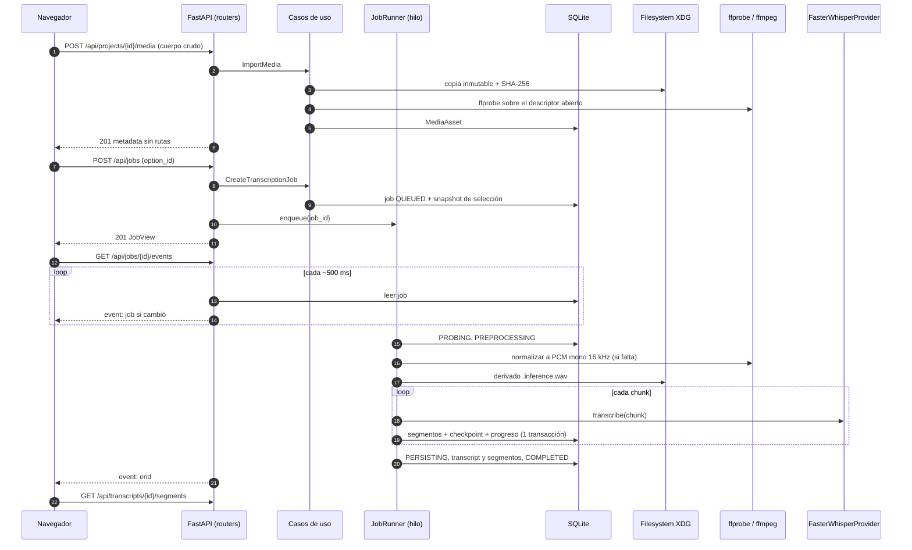

# C4 nivel 3: componentes

Roadmap: S16.11. Nombres de módulos y clases verificados con `grep` sobre
`src/voz/` y `apps/web/src/` en el commit `b775251` más el árbol de trabajo de
la oleada 3. Marco de decisión: [ADR-0001](../adr/0001-modular-monolith.md).

## Regla de dependencia

```text
interfaces ─┐
            ├──> application ──> domain
infrastructure ┘        (ports viven en application/ports)
bootstrap.py ──> todas las capas (único punto que instancia adapters)
```

Comprobado hoy: ningún módulo de `src/voz/domain` ni de `src/voz/application`
importa `fastapi`, `sqlalchemy`, `starlette`, `faster_whisper`, `typer`,
`uvicorn` ni `voz.infrastructure`/`voz.interfaces` (búsqueda por `grep` sin
resultados). Automatizado: solo el dominio (`test_domain_does_not_import_framework_or_persistence_packages`,
que veta `fastapi`, `pydantic` y `sqlalchemy`) y el registry de providers
(`test_registry_has_no_domain_infrastructure_or_framework_imports`). Una guarda
automática para toda la capa `application` es **planificada**; ver
[ADR-0001](../adr/0001-modular-monolith.md).

## Vista de componentes del backend

```mermaid
flowchart TB
    subgraph interfaces["interfaces: traducen transporte, sin reglas de negocio"]
        cli["cli/main.py<br/>Typer: voz, serve, doctor"]
        doctor["cli/doctor.py<br/>run_doctor, render"]
        r_health["api/health.py"]
        r_proj["api/projects.py"]
        r_media["api/media.py<br/>subida de cuerpo crudo"]
        r_stream["api/media_stream.py<br/>original con Range"]
        r_opts["api/transcription_options.py"]
        r_jobs["api/jobs.py + job_views.py"]
        r_sse["api/job_events.py<br/>SSE por sondeo"]
    end

    subgraph application["application: casos de uso y ports"]
        uc_proj["CreateProject, ListProjects"]
        uc_import["ImportMedia"]
        uc_norm["NormalizeImportedMedia<br/>PrepareInferenceAudio"]
        uc_opts["GetTranscriptionOptions"]
        uc_create["CreateTranscriptionJob"]
        runner["JobRunner<br/>máquina de estados, un worker"]
        recov["RecoverableTranscription<br/>chunked_transcription.py"]
        registry["TranscriptionProviderRegistry"]
        devsel["select_execution<br/>asr_device_selection.py"]
        export["export/<br/>TxtExporter, MarkdownExporter, SRT, VTT, JSON"]
        subgraph ports["application/ports"]
            p_repo["Repositories<br/>Project, MediaAsset, Transcript,<br/>Segment, Word, Speaker, TranscriptionJob"]
            p_ckpt["TranscriptionCheckpointStore<br/>TranscriptionJobSelectionRepository"]
            p_store["MediaStoragePort"]
            p_probe["MediaProbePort"]
            p_norm["MediaNormalizationPort"]
            p_audio["InferenceAudioSource"]
            p_prov["TranscriptionProvider"]
            p_model["ModelInstallationPort<br/>TranscriptionModelCatalog<br/>TranscriptionRuntimeProbe"]
        end
    end

    subgraph domain["domain: entidades e invariantes puras"]
        ent["Project, MediaAsset, Transcript, Segment, Word,<br/>Speaker, SpeakerTurn"]
        job["TranscriptionJob + TranscriptionJobState"]
        model["ModelDescriptor, ProcessingProfile"]
    end

    subgraph infra["infrastructure: adapters"]
        sql["persistence/<br/>database.py, schema.py, repositories.py,<br/>transcription_checkpoints.py,<br/>transcription_job_selections.py, migrate.py"]
        mstore["media_storage.py<br/>FileSystemMediaStorage"]
        probe["audio/ffprobe.py<br/>FfprobeMediaProbe"]
        norm["audio/ffmpeg.py<br/>FfmpegMediaNormalizer"]
        inf["inference_audio.py<br/>FileSystemInferenceAudioSource"]
        fw["asr/faster_whisper.py<br/>FasterWhisperProvider"]
        acat["asr/catalog.py, options.py, hardware.py"]
        modst["model_storage.py<br/>FileSystemModelStore"]
        paths["paths.py<br/>resolve_voz_paths (XDG)"]
    end

    boot["bootstrap.py<br/>create_app, create_local_asr_runtime<br/>composition root"]

    cli --> boot
    boot ==>|"instancia y cablea"| infra
    boot ==>|"inyecta en routers"| interfaces

    r_proj --> uc_proj
    r_media --> uc_import
    r_opts --> uc_opts
    r_jobs --> uc_create
    r_jobs --> runner
    r_sse --> p_repo

    uc_import --> p_probe
    uc_import --> p_store
    uc_norm --> p_norm
    uc_norm --> p_store
    uc_create --> uc_opts
    runner --> recov
    runner --> uc_norm
    recov --> p_prov
    recov --> p_audio
    recov --> p_ckpt
    registry --> p_prov
    uc_proj --> p_repo
    uc_import --> p_repo
    runner --> p_repo

    application --> domain

    sql -.->|"implementa"| p_repo
    sql -.->|"implementa"| p_ckpt
    mstore -.->|"implementa"| p_store
    probe -.->|"implementa"| p_probe
    norm -.->|"implementa"| p_norm
    inf -.->|"implementa"| p_audio
    fw -.->|"implementa"| p_prov
    modst -.->|"implementa"| p_model
    acat -.->|"implementa"| p_model
```



> Las flechas de `bootstrap.py` a capas completas resumen decenas de
> constructores; el detalle exacto es `create_app()` y
> `create_local_asr_runtime()` en `src/voz/bootstrap.py`.

## Componentes por capa

### `domain` (`src/voz/domain/entities/`)

Dataclasses inmutables con validación en `__post_init__` y sin imports de
framework.

| Componente | Archivo |
| --- | --- |
| `Project`, `MediaAsset`, `Transcript`, `Segment`, `Word`, `Speaker`, `SpeakerTurn` | `project.py`, `media_asset.py`, `transcript.py`, `segment.py`, `word.py`, `speaker.py`, `speaker_turn.py` |
| `TranscriptionJob`, `TranscriptionJobState` (12 estados, transiciones validadas) | `transcription_job.py` |
| `ModelDescriptor`, `ModelCapability` | `model_descriptor.py` |
| `ProcessingProfile`, `ProcessingProfileName`, `DevicePreference`, `ComputePrecision` | `processing_profile.py` |

### `application` (`src/voz/application/`)

| Componente | Archivo | Rol |
| --- | --- | --- |
| `CreateProject`, `ListProjects` | `projects.py` | Casos de uso de proyectos. |
| `ImportMedia` | `import_media.py` | Copia inmutable, hash, probe y persistencia del `MediaAsset`. |
| `NormalizeImportedMedia`, `PrepareInferenceAudio` | `normalize_media.py`, `prepare_inference_audio.py` | Derivado PCM mono 16 kHz por identidad, sin rutas. |
| `GetTranscriptionOptions` | `get_transcription_options.py` | Opciones con `can_start` y razones de bloqueo. |
| `CreateTranscriptionJob` | `create_transcription_job.py` | Revalida la opción y guarda el snapshot reproducible. |
| `JobRunner` | `job_runner.py` | Un worker, estados explícitos, cancelación, `recover()`, `transcript_id_for`. |
| `RecoverableTranscription`, planificación de chunks | `recoverable_transcription.py`, `chunked_transcription.py` | Un checkpoint atómico por chunk; reanuda sin repetir. |
| `select_execution` | `asr_device_selection.py` | Decisión observable CPU/GPU y motivo de fallback. |
| `TranscriptionProviderRegistry` | `transcription_provider_registry.py` | Registro por ID estable, sin reemplazo. Ver [ADR-0005](../adr/0005-transcription-providers.md). |
| Exportadores puros (`TxtExporter`, `MarkdownExporter`, SRT, VTT, JSON canónico) | `export/` | Renderers sobre segmentos; el cableado HTTP de exportación es trabajo en curso de la oleada 3 y no figura en `bootstrap.py` al escribir esto. |

Ports (`application/ports/`): `repositories.py` (ocho repositories),
`transcription_checkpoint.py`, `transcription_job_selection.py`,
`media_storage.py`, `media_probe.py`, `media_normalization.py`,
`inference_audio.py`, `transcription.py` (`TranscriptionProvider` y tipos
canónicos), `model_installation.py`, `transcription_options.py`.

### `infrastructure` (`src/voz/infrastructure/`)

| Adapter | Archivo | Implementa |
| --- | --- | --- |
| `create_sqlite_engine`, esquema, `Sqlite*Repository` | `persistence/database.py`, `schema.py`, `repositories.py` | Ocho repositories (`Sqlite*Repository`); `bootstrap.py` cablea hoy cinco (proyecto, medio, transcript, segmento, job) y los de palabras, hablantes y turnos quedan sin uso HTTP. |
| `SqliteTranscriptionCheckpointStore` | `persistence/transcription_checkpoints.py` | Commit atómico de chunk, progreso y job. |
| `SqliteTranscriptionJobSelectionRepository` | `persistence/transcription_job_selections.py` | Snapshot de selección. |
| `upgrade_to_head` | `persistence/migrate.py` | Alembic programático (`migrations/versions/`). |
| `FileSystemMediaStorage` | `media_storage.py` | `MediaStoragePort`. |
| `FfprobeMediaProbe` | `audio/ffprobe.py` | `MediaProbePort`. |
| `FfmpegMediaNormalizer` | `audio/ffmpeg.py` | `MediaNormalizationPort`. |
| `FileSystemInferenceAudioSource` | `inference_audio.py` | `InferenceAudioSource`, WAV acotado por chunk. |
| `FasterWhisperProvider` | `asr/faster_whisper.py` | `TranscriptionProvider` (único real). |
| `LocalTranscriptionModelCatalog`, `FasterWhisperRuntimeProbe`, `CTranslate2HardwareProbe`, descriptores `fast`/`quality` | `asr/options.py`, `asr/hardware.py`, `asr/catalog.py` | Catálogo, disponibilidad de runtime y sondeo de hardware. |
| `FileSystemModelStore` | `model_storage.py` | Instalación explícita y resolución local de modelos. |
| `VozPaths`, `resolve_voz_paths` | `paths.py` | Rutas XDG. |

### `interfaces` (`src/voz/interfaces/`)

Un router por recurso. Salvo `health.py` (router estático), cada uno es una
función `create_*_router(...)` que recibe sus dependencias ya construidas
(`api/projects.py`, `media.py`, `media_stream.py`, `transcription_options.py`,
`jobs.py`, `job_events.py`). La CLI vive en `cli/main.py` y `cli/doctor.py`.

### Composition root (`src/voz/bootstrap.py`)

`create_app()` instancia repositories, storage, probe, `JobRunner` y routers;
`create_local_asr_runtime()` compone Faster Whisper para un descriptor exacto
(`LocalAsrRuntime`, con `close()`). `provider_for` crea un runtime por
descriptor bajo demanda y el lifespan los cierra.

## Desviaciones conocidas de la regla de dependencia

Honestas y acotadas; no son violaciones de la regla de `AGENTS.md` (las
interfaces pueden depender de infraestructura), pero merecen atención:

- `interfaces/api/media_stream.py` recibe el adapter concreto
  `FileSystemMediaStorage` y llama a `original_path_for` para servir
  `FileResponse`. La ruta se queda en el servidor: nunca se serializa al
  navegador (test `test_deleted_original_file_is_reported_missing_without_path`).
  Un port de lectura de originales sería más limpio; no está planificado como
  ítem de roadmap.
- `interfaces/cli/doctor.py` usa `CTranslate2HardwareProbe`,
  `FasterWhisperRuntimeProbe` y `resolve_voz_paths` directamente, porque es una
  herramienta de diagnóstico sin caso de uso propio.
- El `JobRunner` (application) usa `threading` y `queue` de la biblioteca
  estándar; es un detalle de ejecución aceptado y marcado con `ponytail:`.

## Flujo principal: importar, transcribir y seguir el progreso



## Frontend (`apps/web/src/`)

| Componente | Archivos | Rol |
| --- | --- | --- |
| Composición | `main.tsx`, `App.tsx` | Estado local de la pantalla; sin store global ni router. |
| Clientes de contrato | `api/health.ts`, `projects.ts`, `media.ts`, `transcriptionOptions.ts`, `jobs.ts`, `jobEvents.ts`, `errors.ts` | Tipan las respuestas (con guardas como `isJobView`) y traducen `{"detail": {"code", "message"}}`. |
| Hooks | `hooks/useJobEvents.ts`, `useSeek.ts` | Suscripción SSE y sincronía audio/segmento. |
| Componentes | `components/NewProjectCard.tsx`, `TranscriptionOptionsSelector.tsx`, `JobScreen.tsx`, `SegmentList.tsx`, `AudioPlayer.tsx`, `HealthStatus.tsx` | Interfaz en español; el reproductor usa `/api/media/{id}/original`. |
| Estilos | `styles.css`, `styles/tokens.css` | Tokens de diseño. |

El frontend no conoce rutas del host, esquema de base de datos ni providers: solo
IDs y los campos del contrato. TanStack Query, Zustand y WaveSurfer.js del plan
maestro son **planificados**: hoy usa `fetch`/`EventSource` y el elemento
`<audio>`.

## Planificado (sin código)

`DiarizationProvider`/`AlignmentProvider`, Model Manager con API/CLI de
instalación, exportación HTTP cableada, edición de transcript, providers
adicionales y `voz.infrastructure.providers.*`: ver secciones 6 a 12 del
[ROADMAP](../../ROADMAP.md).

Anterior: [C4-2 Contenedores](02-contenedores.md). Índice:
[README](README.md).
