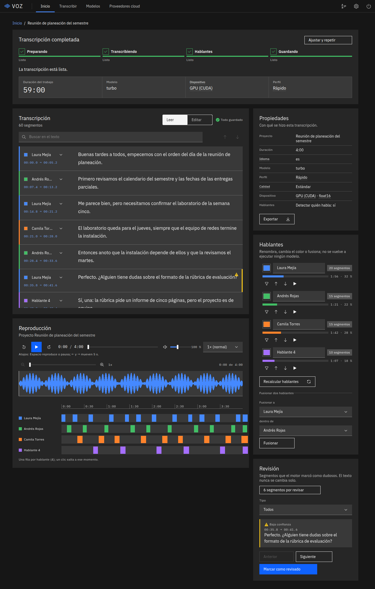
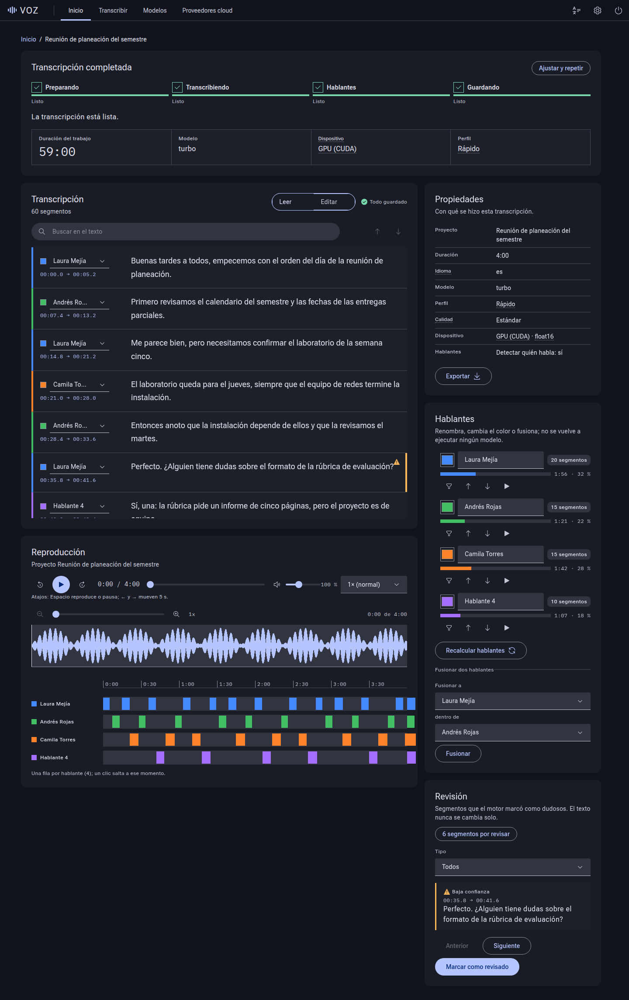
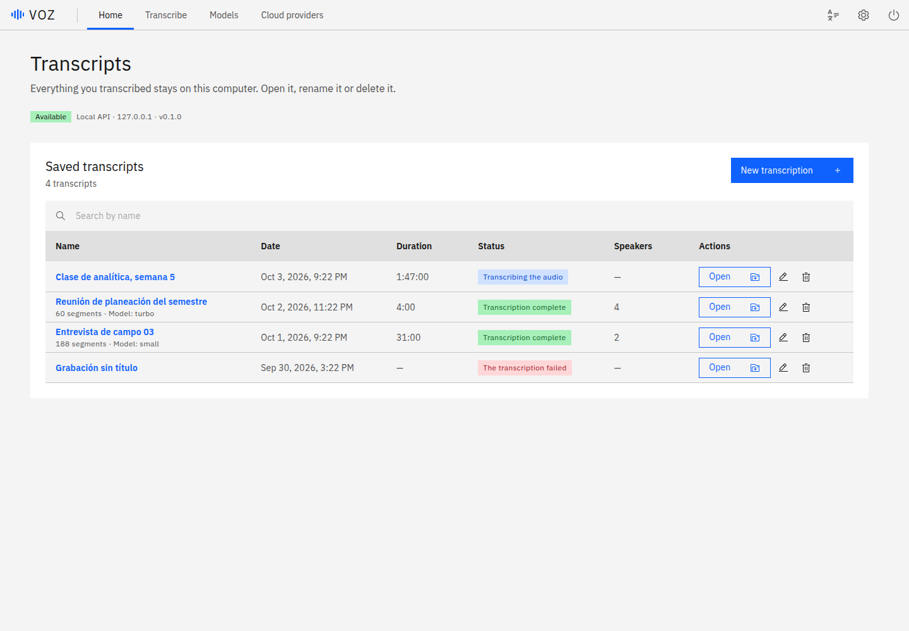
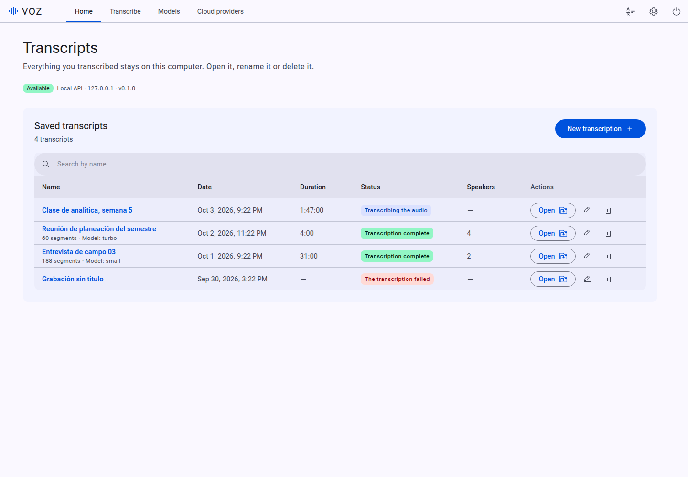

# Material 3 como diseño alternativo de VOZ

Estado: investigación cerrada (C1) e implementación hecha (C2/C3, sección 9).
Fecha de la investigación: 3 de octubre de 2026.

## 1. Decisión

Marshall pidió Material 3 como **diseño alternativo seleccionable** ("Sistema de
diseño: Carbon | Material 3" en Ajustes), no como migración. Carbon sigue siendo el
diseño por defecto y sigue siendo rectangular.

Decisión de implementación: **piel M3 sobre los mismos componentes Carbon**, activada con
`[data-design="m3"]` en `<html>`. Una capa SCSS remapea los tokens `--cds-*` a roles de
color M3, los roles se generan en tiempo de ejecución con
`@material/material-color-utilities` a partir del acento elegido, y la tipografía, las
formas, la elevación y los state layers se cambian solo en ese modo. No se reescribe la
app, no se duplican tests y no se añade `@material/web` salvo para un control concreto
que la piel no consiga resolver (ver 6.9).

Lo que no se hace:

- No se migra a MUI (sigue siendo Material Design 2, ver 4.4).
- No se adopta `@material/web` como base de la interfaz (modo mantenimiento, 4.1).
- No se instala el MCP de `weppa-cloud` (sección 5).
- No se carga nada desde CDN ni desde Google Fonts: el bundle sigue siendo offline.

## 2. Fuentes consultadas

Todas consultadas el 2026-10-03. Los valores numéricos citados salen de los tokens del
repositorio oficial (`tokens/versions/v0_192/*.scss` de `material-web`), no de memoria.

| Fuente | Qué aporta |
| --- | --- |
| https://m3.material.io/ (color, tipografía, formas, elevación, estados, motion) | Especificación de M3. El sitio se renderiza con JavaScript y la herramienta de lectura no extrajo el texto; los valores se verificaron contra los tokens oficiales de `material-web`, que son su traducción literal. |
| https://github.com/material-components/material-web (README, `docs/`, `tokens/`) | Estado del proyecto, componentes, tokens CSS, soporte de navegadores, tamaños. |
| https://github.com/material-components/material-web/discussions/5642 | Anuncio oficial del modo mantenimiento (2024-06-10). |
| https://registry.npmjs.org (`@material/web`, `@material/material-color-utilities`, `@lit/react`, `lit`, `@mui/material`, `@fontsource/*`) | Versiones, fechas, licencias, dependencias. |
| https://github.com/material-foundation/material-color-utilities | API de generación de esquemas desde un color semilla. |
| https://github.com/weppa-cloud/material3-mcp-server y su paquete npm | Evaluación del MCP (sección 5). |
| https://github.com/mui/material-ui/issues/29345 y https://mui.com/blog/2026-and-beyond/ | Estado de M3 en MUI. |
| https://m3.material.io/blog/m3-expressive-motion-theming | Sistema de movimiento de M3 Expressive. |
| Prueba local (scratchpad, no entra en el repo) | API real de `material-color-utilities` 0.4.0, contrastes, tamaño del bundle, pesos de fuentes. |

## 3. Fundamentos de Material 3 relevantes para VOZ

### 3.1 Color: roles y color dinámico

M3 no usa una paleta fija sino **roles semánticos** asignados a tonos de cinco colores
clave (primary, secondary, tertiary, neutral, error). Cada rol tiene su `on-*` con
contraste accesible. Los tokens CSS siguen el patrón `--md-sys-color-<rol>`.

Roles de `material-web` (los que importan aquí):

- Acento: `primary`, `on-primary`, `primary-container`, `on-primary-container`, y lo mismo
  para `secondary`, `tertiary` y `error`.
- Superficies: `background`, `surface`, `surface-dim`, `surface-bright`,
  `surface-container-lowest | low | (sin sufijo) | high | highest`, `on-surface`,
  `on-surface-variant`, `surface-variant`.
- Bordes: `outline`, `outline-variant`.
- Inversos y otros: `inverse-surface`, `inverse-on-surface`, `inverse-primary`, `scrim`,
  `shadow`, `surface-tint` y las variantes `*-fixed`.

La jerarquía de superficies (`surface-container-*`) sustituye a la elevación por tinte de
M3 antiguo: la profundidad se expresa con tonos de superficie, no con sombras fuertes.

**Color dinámico**: dado un color semilla, el algoritmo (espacio HCT) genera paletas
tonales y asigna cada rol a un tono distinto en claro y en oscuro. El nivel de contraste
(0 = estándar, hasta 1 = alto) se pasa como parámetro y recalcula los tonos.

### 3.2 Tipografía

Escala de 15 estilos (display, headline, title, body, label × large/medium/small) con
cinco propiedades cada uno: familia, tamaño, interlineado, peso y tracking. Valores por
defecto verificados en `material-web`:

| Estilo | Tamaño / interlineado | Tracking |
| --- | --- | --- |
| body-large | 1 rem / 1,5 rem | 0,03125 rem |
| body-medium | 0,875 rem / 1,25 rem | 0,015625 rem |
| body-small | 0,75 rem / 1 rem | 0,025 rem |
| display-large | 3,5625 rem (57 px) | según token |

Tipografía por defecto: **Roboto** con tres pesos (400, 500, 700). `--md-ref-typeface-brand`
y `--md-ref-typeface-plain` seleccionan la familia. La documentación de `material-web`
carga Roboto desde Google Fonts; en VOZ **no se puede** (offline), así que se empaqueta.

### 3.3 Formas

Escala de esquinas de `material-web` (valores verificados):

| Token | Valor |
| --- | --- |
| `--md-sys-shape-corner-none` | 0 px |
| `…-extra-small` | 4 px |
| `…-small` | 8 px |
| `…-medium` | 12 px |
| `…-large` | 16 px |
| `…-extra-large` | 28 px |
| `…-full` | 9999 px (píldora/círculo) |

Convención M3: botones, chips y toggles `full`; tarjetas `medium` (12 px); diálogos
`extra-large` (28 px); campos de texto rellenos con esquina superior `extra-small` (4 px);
campos outlined `extra-small`. M3 Expressive añade una biblioteca ampliada de formas y
morfado entre ellas; `material-web` no lo implementa (su hoja de ruta dice que la
expansión de tokens de forma y movimiento "se estaba añadiendo" antes de la pausa).

### 3.4 Elevación

Seis niveles (0 a 5). En reposo se usan 0 a 3; 4 y 5 quedan para estados de interacción
(hover, arrastre). `material-web` los expone como `--md-elevation-level: 0..5` sobre un
elemento `md-elevation`. Las sombras se dibujan con dos capas (clave y ambiente) con desplazamiento vertical
creciente por nivel (0, 1, 1, 1, 2 y 4 px según los comentarios de `_elevation.scss`). En modo oscuro el
nivel se percibe sobre todo por el tono de `surface-container-*`.

### 3.5 State layers

Una capa semitransparente del color del contenido sobre el contenedor indica el estado.
Opacidades verificadas en `_md-sys-state.scss`:

| Estado | Opacidad |
| --- | --- |
| hover | 0,08 |
| focus | 0,12 |
| pressed | 0,12 |
| dragged | 0,16 |

El anillo de foco de `material-web` usa 3 px y el rol `secondary` por defecto.
Los estados deshabilitados usan `on-surface` al 38 % (contenido) y 12 % (contenedor).

### 3.6 Movimiento

Tokens de `material-web`: duraciones `short1..4` = 50, 100, 150, 200 ms;
`medium1..4` = 250, 300, 350, 400 ms; `long1..4` = 450 a 600 ms; `extra-long1..4` =
700 a 1000 ms. Curvas: `standard`, `standard-accelerate`, `standard-decelerate`,
`emphasized`, `emphasized-accelerate`, `emphasized-decelerate` y `linear`
(`standard` = `cubic-bezier(0.2, 0, 0, 1)`). M3 Expressive sustituye parte de las curvas
por **física de resortes** (rápido, por defecto, lento); eso exige JS o la propiedad
CSS `linear()` y queda **fuera de alcance** (VOZ no necesita animación expresiva).
Respetar siempre `prefers-reduced-motion`.

## 4. Opciones de librería

### 4.1 `@material/web` (oficial, Google, Lit)

- Versión 2.5.0 publicada el 2026-07-15; licencia Apache-2.0; ~11,3 mil estrellas;
  dependencias: `lit` (^2.8 o ^3), `tslib`, `@lit/context`. Último push 2026-10-02.
- **Modo mantenimiento** desde el 2024-06-10: "MWC is in maintenance mode pending new
  maintainers". El anuncio oficial dice que no está deprecado, pero no se planean
  componentes ni funciones nuevas, los PR no se aceptan por defecto y el soporte depende
  de tiempo voluntario. La hoja de ruta (`docs/roadmap.md`, revisada 2026-07-31) lo
  confirma: "No future work is planned".
- Componentes existentes: button (elevated, filled, filled-tonal, outlined, text),
  checkbox, chips, dialog, divider, elevation, fab, focus-ring, icon, icon-button, list,
  menu, progress (lineal y circular), radio, ripple, select, slider, switch, tabs,
  text-field (filled y outlined). **Faltan** (siguen "por construir"): autocomplete,
  badge, banner, bottom/top app bar, card, **data table**, date/time picker, navigation
  bar/drawer/rail, search, segmented button, snackbar, tooltip. VOZ usa DataTable, Tag,
  Modal, Toggletip, Search y ContentSwitcher, que no tienen equivalente.
- Navegadores: Chrome y Edge 120+, Firefox 119+, Safari 16.4+.
- Tamaño (medido por el proyecto, 2025-08-20): `all.js` 72,1 kb gzip; un botón ~7 kb gzip;
  `select` 19 a 27 kb gzip; `text-field` y `menu` entre 6 y 14 kb gzip.
- Tema por tokens CSS (`--md-sys-color-*`, `--md-ref-typeface-*`, `--md-sys-shape-*`,
  `--md-sys-typescale-*`) y Sass (`color.light-theme`, `color.dark-theme`). El modo oscuro
  no es automático: la app decide con qué selector aplicar el esquema oscuro.
- Conclusión: es útil como **fuente de verdad de los tokens** y, puntualmente, como
  componente suelto. No sirve como base de toda la UI: sin DataTable, mantenimiento
  congelado y dos sistemas de componentes conviviendo.

### 4.2 `@lit/react` 1.0.8

Licencia BSD-3-Clause, peer `@types/react` 17/18/19. `createComponent` envuelve un custom
element de Lit para React con props tipadas y eventos mapeados. **React 19 (el de VOZ, 19.2.7)
ya soporta elementos personalizados de forma nativa** (props como propiedades, eventos con
`on<nombre>`), así que el envoltorio solo aporta tipos y nombres de eventos más cómodos.
Se usaría únicamente en el caso de excepción de 6.9. Riesgo a verificar en C2: jsdom
(vitest) tiene soporte incompleto de `ElementInternals`, del que dependen los controles
de formulario de `material-web`; los tests tendrían que evitar montar esos componentes o
mockearlos.

### 4.3 `@material/material-color-utilities` 0.4.0

Licencia Apache-2.0, publicada el 2026-01-21 (repo con ~2,3 mil estrellas y actividad en
2026-08). Es la implementación de referencia del color dinámico. Verificado en prueba
local:

- API usable: `Hct.fromInt(argbFromHex(seed))`, un esquema (`SchemeTonalSpot`,
  `SchemeVibrant`, `SchemeContent`, `SchemeFidelity`, `SchemeNeutral`,
  `SchemeMonochrome`, `SchemeExpressive`, `SchemeRainbow`, `SchemeFruitSalad`) con
  `(hct, isDark, contrastLevel)`, y `new MaterialDynamicColors().<rol>().getArgb(esquema)`
  para cada rol (en 0.4.0 los roles son **métodos de instancia**, no estáticos; el código
  de ejemplo antiguo con `MaterialDynamicColors.primary` ya no sirve).
  `themeFromSourceColor` + `applyTheme` existen y escriben `--md-sys-color-*` en un
  elemento, pero solo dan los roles del esquema clásico; los `surface-container-*` se
  obtienen con `MaterialDynamicColors` (confirmado: `surfaceContainerLowest … Highest`,
  `surfaceDim`, `surfaceBright`).
- Es ESM con imports sin extensión (`./dynamic_scheme`): **falla en Node puro**, funciona
  con bundlers. Vite/Vitest lo resuelven; no importarlo desde scripts de Node sin bundler.
- Tamaño: importando solo un esquema + `MaterialDynamicColors` + utilidades de color, el
  bundle minificado de prueba fue de 89 kB sin comprimir y **20,5 kB gzip**. Cargarlo con
  `import()` dinámico solo al activar M3 lo deja fuera del camino de Carbon.
- Sin dependencias de ejecución.

Colores de acento medidos (tema claro) con `SchemeTonalSpot` frente a `SchemeVibrant`
desde los 8 acentos de Carbon (rampa 60). Contraste de `primary` sobre `surface`
siempre ≥ 6,1:1 y de `on-primary` sobre `primary` ≥ 6,4:1 (cumple AA y AAA para texto
normal):

| Acento (semilla) | TonalSpot | Vibrant |
| --- | --- | --- |
| blue `#0f62fe` | `#4b5c92` (índigo apagado) | `#0052dd` (azul) |
| teal `#007d79` | `#006a66` | `#006a66` |
| green `#198038` | `#36693d` | `#006e2b` |
| purple `#8a3ffc` | `#69548d` | `#7b00fc` |
| magenta `#d02670` | `#8c4a5e` (rosa apagado) | `#ba005f` |
| red `#da1e28` | `#904a45` (marrón) | `#c0001a` |
| orange `#ba4e00` | `#8d4e2c` (marrón) | `#9f4200` |
| neutral `#525252` | `#006874` (verdeazulado, tono arbitrario) | `#006874` |

Consecuencia de diseño: **TonalSpot** (el valor por defecto de Google, pastel) desvirtúa
el selector de acento de VOZ: el rojo se vuelve marrón y el azul índigo. Recomendación:
**`SchemeVibrant`** para los acentos cromáticos (mantiene el tono reconocible; sigue
siendo M3 válido) y **`SchemeMonochrome`** (o `SchemeNeutral`) para `neutral`, porque con
croma 0 el matiz de la semilla no existe y TonalSpot/Vibrant inventan un teal. La
decisión final se confirma con capturas en C3; el esquema es un parámetro de una sola
línea.

### 4.4 MUI

`@mui/material` 9.4.0 (2026-08-27, MIT) sigue implementando **Material Design 2**. El
issue de adopción de M3 (mui/material-ui#29345) sigue abierto (último movimiento
2026-06-03, 174 comentarios) y el blog "2026 and beyond" no lo planifica. Además exige
Emotion y duplicaría el sistema de componentes. Descartado.

### 4.5 Tipografía empaquetada (offline)

Opciones medidas en `@fontsource` (licencia OFL-1.1, v5.3.0, julio 2026):

| Paquete | Archivos | Tamaño |
| --- | --- | --- |
| `@fontsource/roboto` (estática) | latin 400, 500, 700 `.woff2` | 21,9 + 22,2 + 22,2 kB = ~66 kB |
| `@fontsource-variable/roboto-flex` | `latin-wght-normal.woff2` (solo eje de peso) | 34,3 kB |

Recomendación: **Roboto Flex variable, solo eje `wght`** (34 kB, cubre 400/500/700 y
cualquier peso intermedio); alternativa más simple y fiel a la especificación: Roboto
estática 400/500/700 (66 kB). Ambas se importan desde `node_modules` con Vite, igual que
IBM Plex hoy en `styles/index.scss`; subconjunto latino cubre es/en. No se usa
`fonts.googleapis.com`.

## 5. Por qué no se instala `weppa-cloud/material3-mcp-server`

Datos verificados: 6 estrellas, un solo autor, creado el 2025-09-29 y sin cambios desde
el 2025-09-30 (versión 1.1.1, MIT, ~12 meses sin mantenimiento). Se ejecuta con
`npx -y @weppa-cloud/material3-mcp-server` y usa `axios`, `cheerio` y la API de GitHub
(cobertura "web": lee TypeScript de `material-web`; "flutter": lee Dart de
`flutter/flutter`) e Iconify para iconos; el scraping de m3.material.io figura como
"futuro". Razones para no instalarlo:

1. **Aporta poco.** Todo lo que sirve es información pública de `material-web`, que ya
   se leyó directamente en esta investigación (tokens, componentes, docs) con valores
   verificados.
2. **Cadena de suministro.** `npx -y` ejecuta código de un paquete sin revisión de un
   mantenedor único y sin actividad, con 10 dependencias directas, en la máquina de
   Marshall (que ya tuvo un info-stealer en 2026). El beneficio no compensa el riesgo.
3. **Red en tiempo de uso.** Depende de la API de GitHub (60 peticiones/hora sin token;
   el paquete anima a poner un `GITHUB_TOKEN`, es decir, más credenciales en la
   configuración).
4. **Cobertura incorrecta para VOZ.** Su soporte "React" figura como "próximamente" y la
   salida que interesa (tokens CSS/SCSS) está en un único directorio de un repositorio
   público.
5. **Regla del proyecto.** `AGENTS.md` exige documentar por qué no bastan la biblioteca
   estándar y las dependencias existentes antes de añadir una; aquí no hay razón que lo
   justifique.

Alternativa sin instalar nada: los tokens oficiales (`tokens/versions/v0_192/`) y los
documentos de `material-web/docs/theming/` bastan; esta nota los cita.

## 6. Diseño de la piel M3 para VOZ

### 6.1 Preferencia

`apps/web/src/theme/appearance.ts` (el mismo módulo del tema y el acento):

- Nuevo tipo `DesignSystem = 'carbon' | 'm3'`, constante `DESIGN_SYSTEMS`, clave
  `localStorage` `voz.design`, valor por defecto `'carbon'`, lectura y escritura con
  `try/catch` como las demás.
- `applyAppearance(theme, accent, design)` pone `data-design` en `<html>`. Carbon sigue
  usando las clases de zona `cds--white | g10 | g90 | g100` para claro/oscuro; **no se
  cambia esa lógica**: M3 deriva su modo de la zona resuelta (`g10/white` = claro,
  `g90/g100` = oscuro). Así los cuatro temas de Carbon siguen existiendo y "sistema"
  sigue funcionando.
- `useAppearance` devuelve también `design` y `setDesign`.
- Selector en el menú de Ajustes (junto a tema y acento): dos opciones, "Carbon" y
  "Material 3", con las etiquetas en el catálogo i18n es/en y un tooltip que explica que
  es solo el aspecto visual.
- Tests (`appearance.test.ts`): valor por defecto, persistencia, valor inválido en
  `localStorage` cae a `'carbon'`, `localStorage` que lanza no rompe, atributo en
  `<html>`.

### 6.2 Generación de roles desde el acento

Nuevo módulo `apps/web/src/theme/m3.ts` (cargado con `import()` dinámico solo si
`design === 'm3'`):

```
seed = ACCENT_SWATCH[accent]            // ya existe en appearance.ts
scheme = accent === 'neutral' ? SchemeMonochrome : SchemeVibrant
for dark of [false, true]: roles = { 'primary': M.primary().getArgb(s), ... }
```

Solo se generan los ~28 roles que usa la capa SCSS (sección 6.3). Se aplican como
propiedades CSS con `element.style.setProperty('--md-sys-color-<rol>', hex)` sobre
`<html>` (el CSSOM no choca con una CSP restrictiva de `style-src`; no se inyecta
`<style>`). Se recalculan al cambiar acento o zona (claro/oscuro). El contraste se deja
en 0 (estándar); opcionalmente un nivel de contraste alto más adelante, ya que es un
parámetro del esquema.

### 6.3 Mapeo de tokens Carbon a roles M3

Capa `apps/web/src/styles/m3/` importada **después** de `./accent` y `./shape`, con todos
los selectores bajo `[data-design='m3']` más la clase de zona para ganar a Carbon
(`[data-design='m3'].cds--g100`, etc.; especificidad (0,2,0) y orden de importación
posterior). Las reglas de acento de `_accent.scss` se anulan en este modo porque el
acento ya entra por la semilla.

| Token Carbon | Rol M3 |
| --- | --- |
| `--cds-background` | `surface` |
| `--cds-layer-01` | `surface-container-low` |
| `--cds-layer-02` | `surface-container` |
| `--cds-layer-03` | `surface-container-high` |
| `--cds-layer-accent-01` | `surface-container-highest` |
| `--cds-field-01` / `--cds-field-02` | `surface-container-highest` / `surface-container-high` |
| `--cds-border-subtle-00/01/02` | `outline-variant` |
| `--cds-border-strong-01/02/03`, `--cds-border-inverse` | `outline` |
| `--cds-text-primary` | `on-surface` |
| `--cds-text-secondary`, `--cds-text-helper`, `--cds-icon-secondary` | `on-surface-variant` |
| `--cds-text-placeholder` | `on-surface-variant` al 60 % (`color-mix`) |
| `--cds-text-disabled`, `--cds-icon-disabled` | `on-surface` al 38 % |
| `--cds-text-on-color`, `--cds-icon-on-color` | `on-primary` |
| `--cds-icon-primary` | `on-surface-variant` |
| `--cds-interactive`, `--cds-link-primary`, `--cds-icon-interactive`, `--cds-border-interactive`, `--cds-button-primary` | `primary` |
| `--cds-link-primary-hover`, `--cds-button-primary-hover` | `primary` mezclado con 8 % de `on-primary` |
| `--cds-button-primary-active` | `primary` mezclado con 12 % de `on-primary` |
| `--cds-button-secondary` | `secondary-container` (y el texto del botón pasa a `on-secondary-container`) |
| `--cds-button-tertiary` | `primary` (variante outlined: borde `outline`) |
| `--cds-button-danger-primary` | `error` |
| `--cds-focus` | `secondary` (como el anillo de `material-web`) |
| `--cds-highlight`, `--cds-background-selected` | `secondary-container` |
| `--cds-background-hover`, `--cds-layer-hover-0*` | `on-surface` al 8 % sobre la superficie |
| `--cds-support-error` | `error` |
| `--cds-support-info` | `primary` |
| `--cds-support-success`, `--cds-support-warning` | colores a medida (M3 no tiene rol): `customColor` con `blend: true` del propio esquema, o verdes/ámbar fijos con contenedor y `on-` generados |
| `--cds-overlay` | `scrim` al 32 % |
| `--cds-tag-background-*` / `--cds-tag-color-*` | `*-container` / `on-*-container` equivalentes |

Las mezclas con `color-mix(in srgb, ...)` se escriben **una vez en SCSS** referenciando
las variables de rol, de modo que cambiar acento o claro/oscuro solo toca los ~28 roles
en `<html>`. `color-mix` es estándar en Chrome 111+, Firefox 113+, Safari 16.2+, por
debajo del mínimo de `material-web` (Chrome 120, Firefox 119, Safari 16.4).

### 6.4 Tipografía

Roboto Flex (variable, solo `wght`) o Roboto estática empaquetada (4.5). En
`[data-design='m3']`: `--cds-body-*`/`font-family` de la app a `Roboto Flex`, y escala
M3 aplicada a los componentes que Carbon tipifica con tokens propios (`--cds-heading-*`,
`--cds-label-*`, `--cds-body-*`, `--cds-helper-text-*`): body-medium (14/20) para la
mayor parte, label-large (14, peso 500) para botones, title-large para cabeceras de
modal, headline para títulos de página. La fuente monoespaciada (tiempos, transcripción)
**no** cambia: se mantiene IBM Plex Mono.

### 6.5 Formas (solo en M3)

Carbon sigue rectangular: `_shape.scss` y `border-radius: 0` de la app no se tocan. La
capa M3 define `--m3-shape-*` con los valores de la sección 3.3 y los aplica a:

- Botones (`.cds--btn`), IconButton, Toggle y buscador: `full`; RadioButton circular.
- Tag: `small` (8 px, como los chips de M3).
- Tiles, paneles, panel de Ajustes y notificaciones: `medium` (12 px). Menús y
  listas desplegables: `extra-small` (4 px), como el menú de M3.
- Modal: `extra-large` (28 px).
- TextInput/Select/Search/NumberInput: contenedor relleno con esquinas superiores de 4 px
  y línea inferior del `outline`/`primary` al foco (variante "filled" de M3).
- Ya existen `border-radius: 0` en `AudioPlayer.scss` (4 sitios) que, bajo
  `[data-design='m3']`, se sobrescriben a `medium` donde corresponda; hay que revisarlos
  en C2.

### 6.6 Elevación y state layers (solo en M3)

- Niveles 0 a 3 como variables `--m3-elevation-*` (`box-shadow` de dos capas calculado a
  partir de la tabla de `material-web`), usados en Menu/Popover (nivel 2), Modal (nivel 3) y
  botones elevados; el resto, plano con tono de superficie. En oscuro se prioriza el
  tono sobre la sombra.
- State layers con `::before` o `box-shadow: inset` sobre el contenedor: hover 8 %, focus
  12 %, pressed 12 %, arrastre 16 %, usando `currentColor` del contenido (`on-primary` en
  botones rellenos, `primary` en outlined y texto, `on-surface` en filas y listas). Se
  reemplazan las variantes `-hover`/`-active` sólidas de Carbon por estas capas donde el
  mapeo de 6.3 no basta. Ripple dinámico (el de `material-web`) queda fuera: la capa
  estática cubre el 95 % de lo percibido.
- Foco visible: anillo de 3 px en `secondary` con desplazamiento de 2 px, como
  `md-focus-ring`. Se mantiene el foco por teclado de Carbon (accesibilidad) y solo se
  cambia su color y forma.
- Movimiento: duración `short4` (200 ms) y curva `standard`
  (`cubic-bezier(0.2, 0, 0, 1)`) para cambios de estado; `medium2` (300 ms) y
  `emphasized-decelerate` para aparición de modales; todo bajo
  `@media (prefers-reduced-motion: no-preference)`.

### 6.7 Estructura de archivos

```
apps/web/src/
  theme/appearance.ts        # + DesignSystem, voz.design, data-design
  theme/m3.ts                # generación de roles (import() dinámico)
  theme/m3.test.ts           # roles para los 8 acentos, claro/oscuro, contraste >= 4.5
  styles/m3/_roles.scss      # mapeo Carbon -> M3 (tabla 6.3)
  styles/m3/_shape.scss      # formas M3
  styles/m3/_elevation.scss  # niveles y state layers
  styles/m3/_type.scss       # Roboto + escala
  styles/m3/index.scss       # se usa desde styles/index.scss tras ./accent y ./shape
```

### 6.8 Criterios de aceptación (C2 y C3)

- Carbon sin cambios visibles: las capturas de Carbon previas a la capa son idénticas.
- Con `data-design="m3"`: todos los componentes de VOZ cumplen la tabla 6.3 y las formas
  de 6.5; claro y oscuro; es y en; los 8 acentos.
- Contraste: texto normal ≥ 4,5:1 y componentes/iconos ≥ 3:1 en ambos modos; test que
  calcula los pares principales (`on-surface/surface`, `on-primary/primary`,
  `on-secondary-container/secondary-container`, `error/on-error`, `outline/surface`).
- Bundle: `grep -rE "https?://" dist/` sin URLs de fuentes ni de CDN (la cadena
  `elevenlabs` y "Buzz" siguen ausentes); las fuentes salen de `node_modules`.
- `npm run lint`, `typecheck`, `npx vitest run`, `npm run build` verdes; capturas Carbon vs
  M3 revisadas con Read.

### 6.9 Cuándo (y solo cuándo) usar `@material/web` + `@lit/react`

Solo si un control de Carbon queda irreparablemente mal con la piel, y solo en modo M3.
Candidatos probables: ninguno en la primera pasada (los componentes de VOZ son botones,
campos, selects, toggles, radios, tags, tablas, modales, menús, barra de progreso). El
único candidato real es el **slider** del reproductor de audio si el de Carbon no admite
una forma M3 aceptable; el slider de M3 (`md-slider`) existe. Antes de añadirlo se
evalúan: coste de ~10 kB gzip del componente, `ElementInternals` en jsdom, y el hecho de
que dejaría de ser un componente Carbon (accesibilidad y teclado a verificar). Regla: si
se añade `@material/web`, se importa **solo** el módulo concreto
(`@material/web/slider/slider.js`) con carga dinámica y se registra únicamente al
activar M3.

## 7. Coste y riesgos

Estimación de trabajo para C2 + C3 (un agente Sonnet, un solo hilo; sin tocar el
backend):

| Pieza | Esfuerzo |
| --- | --- |
| Preferencia + selector + i18n + tests | bajo (~0,5 día) |
| `m3.ts` (generación de roles, carga dinámica, tests de contraste) | bajo-medio (~0,5 día) |
| Capa SCSS: mapeo de colores y formas | medio (~1 día) |
| State layers, elevación, tipografía, foco | medio (~1 día) |
| Retoques por componente (campos rellenos, tags, notificaciones, DataTable, Modal) | medio-alto (~1 día; es donde está el riesgo) |
| Capturas Carbon vs M3 (claro/oscuro, es/en), revisión, ajustes | bajo-medio (~0,5 día) |

Total orientativo: 3 a 4 días-agente, frente a semanas de una migración real. Coste en
mantenimiento: bajo mientras los componentes sean Carbon, porque la piel solo toca
tokens y variables CSS.

Riesgos:

- **Especificidad y orden de CSS.** Carbon aplica sus tokens por clase de zona; la capa
  M3 debe ganar sin `!important`. Mitigación: selector doble (`[data-design]` + clase de
  zona) e importar tras `./accent`.
- **Componentes con estilo propio de Carbon** (DataTable, Modal, ListBox, Toggle) usan
  valores de borde y altura (32/40/48 px) que no son los de M3. La piel mantiene las
  alturas de Carbon (densidad), por lo que no será una réplica píxel a píxel de las
  especificaciones de M3 (p. ej. botones de 40 px con esquina `full`, no de 48). Esto es
  una decisión consciente: M3 como "aspecto", no como paridad total.
- **Sin rol de éxito/aviso en M3** (6.3): se resuelve con colores a medida; añade 2 roles
  fuera del esquema.
- **`SchemeVibrant` frente a la recomendación de Google (TonalSpot).** Es una desviación
  deliberada (4.3); los esquemas dependen solo de una constante.
- **`material-color-utilities` 0.4.0 es ESM con imports sin extensión.** Vite/Vitest lo
  resuelven; Node plano no. No importarlo en scripts de línea de comandos sin bundler.
- **Dependencia de un proyecto en mantenimiento** (`@material/web`): mitigado al no
  depender de él salvo en el caso de excepción de 6.9 y por ser tokens/estilos
  estables.
- **Peso**: +~20 kB gzip de color utilities (carga diferida), +34 a 66 kB de fuente
  (solo se pide si `data-design="m3"`, con `font-display: swap`), +~10 kB de CSS.
- **Reglas de VOZ.** "Nada genérico de IA" y "Carbon cuadrado": M3 solo existe como
  opción explícita; el primer arranque y el valor por defecto siguen siendo Carbon.

## 8. Referencias

- https://m3.material.io/ (color, typography, shape, elevation, state layers, motion)
- https://m3.material.io/blog/m3-expressive-motion-theming
- https://github.com/material-components/material-web (`docs/theming/color.md`,
  `typography.md`, `shape.md`, `docs/support.md`, `docs/roadmap.md`, `docs/size.md`,
  `tokens/versions/v0_192/`)
- https://github.com/material-components/material-web/discussions/5642
- https://github.com/material-foundation/material-color-utilities
- https://www.npmjs.com/package/@material/material-color-utilities
- https://www.npmjs.com/package/@lit/react
- https://github.com/mui/material-ui/issues/29345
- https://github.com/weppa-cloud/material3-mcp-server
- https://fontsource.org/fonts/roboto-flex

## 9. Implementación (C2 y C3)

Hecha el 2026-10-03 siguiendo las secciones 6.1 a 6.9, con estas diferencias:

- Los tokens de tipo de Carbon son variables CSS (`--cds-body-compact-01-font-size`,
  etc.) y los estilos sans no fijan `font-family` (la heredan), así que la tipografía M3 se
  aplica poniendo la familia en `body`, `.voz-app` y los controles, y sobrescribiendo las
  variables de la escala; el código sigue en IBM Plex Mono.
- `data-design` solo se marca **después** de publicar los roles (`applyDesign` es
  asíncrona y una llamada nueva descarta la anterior); `main.tsx` espera `settleDesign()`
  para no pintar M3 sin colores en el primer render.
- Los 8 acentos usan `SchemeVibrant`; `neutral` usa `SchemeMonochrome`. Éxito y aviso son
  roles a medida (`--voz-m3-success*`, `--voz-m3-warning*`), armonizados hacia el acento.
- Vitest necesita `test.server.deps.inline: ['@material/material-color-utilities']`
  (`apps/web/vite.config.ts`): sin eso falla por los imports sin extensión de la sección 4.3.
- `@material/web` y `@lit/react` **no** se instalaron: ningún control hizo falta (6.9).
- Dependencias nuevas (versiones exactas): `@material/material-color-utilities` 0.4.0
  (Apache-2.0; bloque aparte de 19,5 kB gzip, solo se descarga en modo M3) y
  `@fontsource-variable/roboto-flex` 5.3.0 (OFL-1.1; un único `woff2` de 34 kB del eje
  `wght`, se descarga solo si algo usa la fuente). Ni una URL externa en el bundle.

Archivos: `apps/web/src/theme/appearance.ts` y `m3.ts` (más sus tests),
`apps/web/src/styles/m3/` (`_tokens`, `_type`, `_shape`, `_components`), selector en
`components/HeaderMenus.tsx` y textos en `i18n/messages/shell.ts`.

Comparativas Carbon frente a M3 (dark/es y light/en: inicio, espacio de trabajo, Ajustes,
exportar y renombrar) y los acentos: `docs/assets/screenshots/m3-*.png`.

## Capturas

Carbon (por defecto) frente a Material 3, con datos de demostración:

| Carbon | Material 3 |
| --- | --- |
|  |  |
|  |  |

Ajustes en Material 3 ([oscuro](../assets/screenshots/m3-m3-dark-es-settings.png),
[claro](../assets/screenshots/m3-m3-light-en-settings.png)) y
[acentos](../assets/screenshots/m3-accents-dark-es.png).
